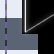

# МАЯ-689 · Отражение света от прямой грани

20 ноября 2026. Статус: исправление по чтению исходника; проверки пользователем. Тесты, синтаксическая проверка, браузер и приложение для этой задачи не запускались.

## Причина по коду

`Field.normal` усреднял направления к занятым клеткам в радиусе3 вокруг последней свободной позиции луча. Эта оценка зависит от дробной координаты удара и соседних клеток возле конца площадки. Поэтому горизонтальная грань могла получить ненулевую горизонтальную составляющую нормали, а вертикально падающий луч — боковое отклонение. Снимок не содержит полного состояния поля; точный пользовательский сеанс не воспроизводился.

## Изменение

В normal передаётся клетка столкновения и уже пройденная оптическая среда. Сначала определяется пересечённая открытая грань. Для горизонтального или вертикального ровного участка (включая его конец) используется точная осевая нормаль; для отдельной клетки без диагонального продолжения — нормаль пересечённой грани. При переходе через две грани учитывается порядок пересечений; точный угол остаётся неоднозначным и использует прежнюю оценку контура.

На горизонтальной грани преобразование скорости: `(vx,vy) → (vx,−vy)`, в частности `(0,1) → (0,−1)`. На вертикальной: `(vx,vy) → (−vx,vy)`. Диагональный контур без прямого участка сохраняет прежний расчёт. Оптическая маска нормали теперь совпадает с маской столкновения и исключает уже пройденный пропускающий слой.

Водный расчёт, доли разделения света, ослабление и настройки не менялись. Маятник v1.040 обновляет подключение общего ядра.

## Подготовленные проверки

В `_js/hub-flow-core.test.cjs` добавлены три группы регрессионных случаев: вертикальное падение/подъём на дробных x и концах горизонтальной площадки; горизонтальное падение на вертикальную грань и отдельная клетка; наклонное падение с сохранением касательной скорости. Существующий случай отражения от диагональной стены сохранён. **Новые и существующие тесты в этой задаче не выполнялись.** Код/diff прочитаны root и внутренним flow_port.

Публикация и HTTP-доставка фиксируются в `2026-11-20-mayatnik-light-delivery.json`.

Граница растрового метода: ступень наклонного контура длиной две и более клеток распознаётся как прямая грань. Отличить такую ступень от самостоятельной короткой площадки без исходной аналитической геометрии нельзя; это отмечено при независимом чтении.
