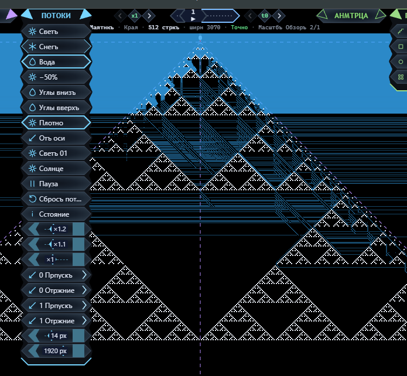

# МАЯ-688 · Диагональный шлейф воды

20 ноября 2026. Статус: причина воспроизведена в ядре, исправление подготовлено; адресные тесты пройдены. Исходный пользовательский сеанс в браузере не запускался.



## Причина

Дефект находится в `WaterField.levelBodies` общего `_js/hub-flow-core.js`, не в отрисовке canvas. При поиске места для выравнивания алгоритм сначала выбирал самую нижнюю доступную строку, затем последний добавленный сосед справа. Поиск прекращался, когда заканчивался объём воды, ещё до обнаружения открытого слива. Пройденный путь становился заполненными клетками: получалась диагональ вправо-вниз в воздухе.

Дополнительно дробный остаток распределялся по всей доступной горизонтальной строке без проверки опоры. Это создавало длинные горизонтальные полосы. Визуализация малых масс делала полосы заметными, но изменение прозрачности не исправило бы перенос массы.

## Воспроизведение

Опыты используют только WaterField, без света, снега, DOM и canvas.

| Опыт | До исправления | После |
|---|---|---|
| Поле41×32, полка x12…17/y10, шесть единичных масс над ней, один levelBodies | Массы по1 в (17,9),(18,10),(19,11),(20,12),(21,13),(22,14), без опоры | Выравнивание не переносит воду; падение выполняется обычным шагом |
| Полка x12…28/y10, 24 раза stepWater и fillTop | Ниже допустимого фронта y24 находилось16 единиц воды | Ниже фронта0; объём с учётом стока сохраняется |
| Полка x11…15/y10, две массы по0.6 в (12,9),(13,9) | Дробная поверхность распространялась в пустоту; простой промежуточный guard только полных клеток также пропускал это | Проверяется весь план, включая дробный слой; вода остаётся до обычного шага |

Первые два новых регрессионных теста были запущены до исправления и оба завершились ошибкой. Независимый внутренний flow_port подтвердил причину и нашёл дробный контрпример.

## Исправление

Перераспределение сначала готовится в отдельном плане, включая дробную поверхность и воду, встреченную по пути. До изменения поля проверяется опора каждой положительной массы: твёрдая клетка либо заполненная водой клетка непосредственно снизу с учётом результата всего плана. Неподдержанный план целиком отклоняется без потери массы; открытое падение остаётся обычному расчёту stepWater. Полного дополнительного обхода пустого экрана нет.

## Выполненные проверки

Прямой запрос пользователя «проверь Воду» разрешает адресные проверки этого дефекта. Выполнена команда:

```text
node --test --test-name-pattern='water|liquid|level|shaft|corner|dense source' _js/hub-flow-core.test.cjs
```

Результат: **17/17 PASS**, включая три новых регрессии, сохранение массы, чашу/перелив, дренаж, плотный фронт, движение препятствий, сообщающиеся сосуды и углы вниз/вверх. Остальные тесты приложения, браузерная и визуальная приёмка не запускались. Точное состояние из снимка не получено: доказательство основано на изолированных воспроизводимых случаях с теми же двумя артефактами.

Маятник v1.039 сохраняет стандартные ползунки v1.038; обновлён cache общего ядра. Подробности HTTP-доставки записываются в `2026-11-20-mayatnik-water-delivery.json`.
