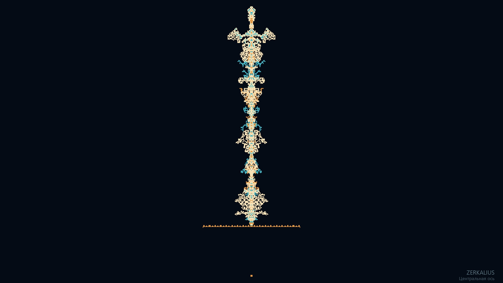

# Маятник — центральная ось · янтарь и бирюза

Новый цвет и композиция для [ролика владельца](https://www.youtube.com/watch?v=Fyc9d5H1E8U), по запросу 21 ноября 2026.

[Видео Full HD · 6,9 МБ](central-axis-templates-v2-amber-turquoise-1080p.mp4)



Тёмно-синий рисунок, который терялся на чёрном фоне, стал бирюзовым. Основные области — светлая слоновая кость и янтарь. Фон — глубокий синий. Весь исходный холст помещён в высоту 1032 пикселя с полями по 24 пикселя; форма не обрезана. Клетки сохраняют жёсткие края, новые детали и промежуточные состояния не выдумываются.

Источник — собственный GIF из [Журнала картинок](https://1001100.online/issledovanie/image-journal/#central-axis-templates): 537×413, 194 состояния, 183,61 секунды. В пакет включён оригинал central-axis-source.gif. Полная последовательность и длительности сохранены; при кодировании время округляется до сетки 30 кадров/с. Итог 1920×1080, H.264 CRF15, 183,60 секунды. Звука нет, как в исходном видео.

Это новая оформленная версия для оценки владельцем. Старый ролик YouTube сохранён; новый файл на YouTube не загружен.

## Пересборка

Python, NumPy, Pillow, FFmpeg; шрифт Segoe UI. Из этой папки запустить:

```text
python render_central_axis_v2.py
```

Точные цвета, размер, временные интервалы и SHA-256 исходника — central-axis-v2-manifest.json; параметры готового файла — delivery.json. Просмотрен один подготовленный кадр для выбора вида; полный просмотр новой версии остаётся пользователю. Новая запись из исходного поля Маятника в большем разрешении потребует соответствующего сохранённого состояния; эта версия честно использует исходный GIF.
