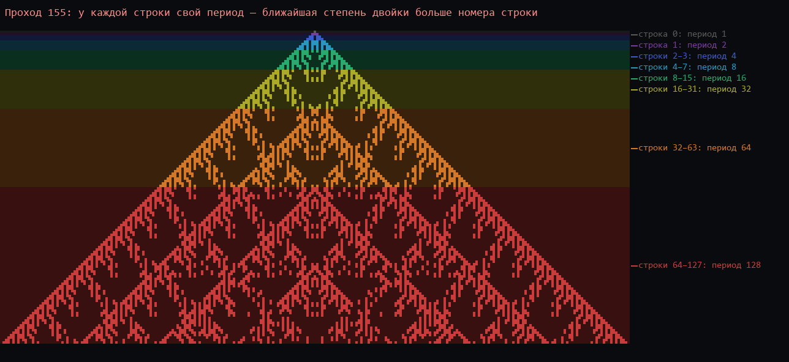
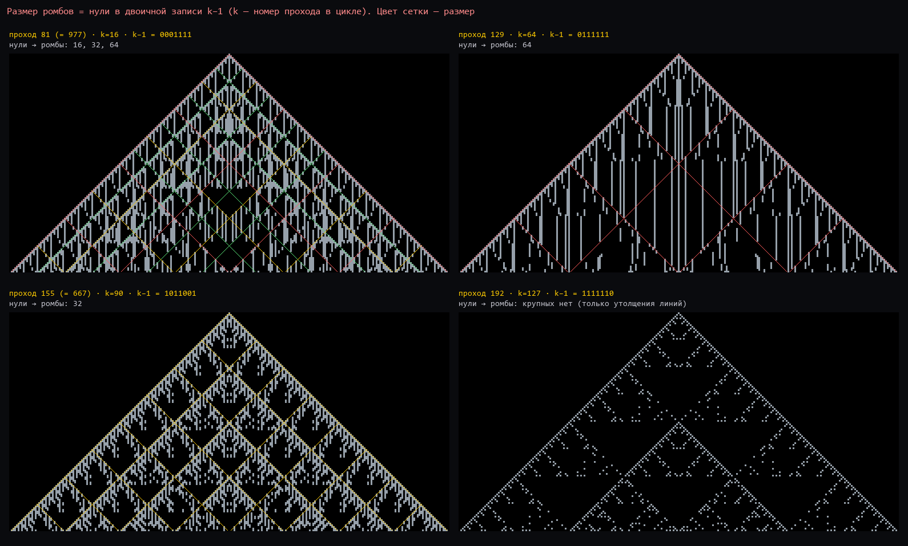
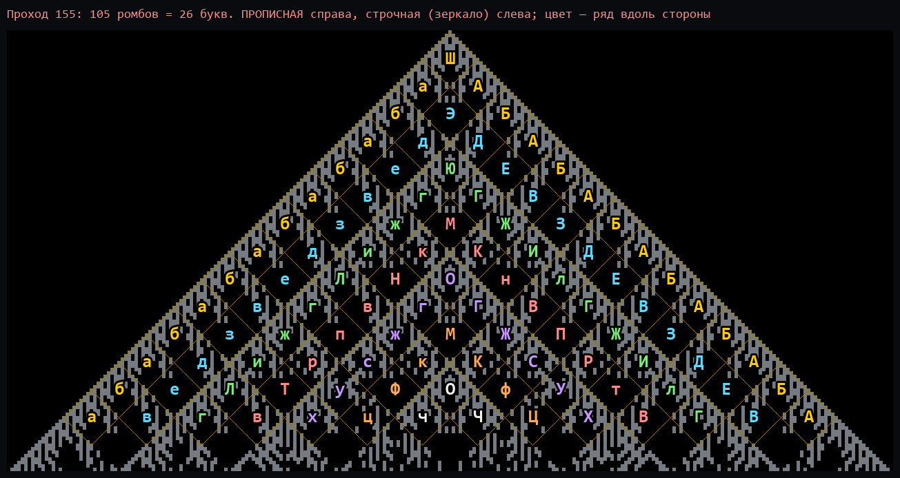
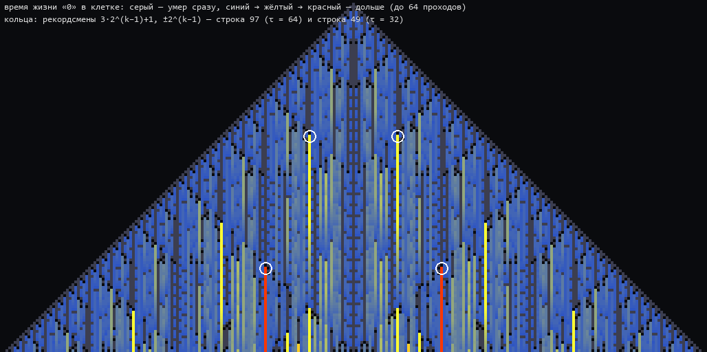

# Две Аниматрицы: Code и Маятник/Excel

**Версия 0.002 · 20 ноября 2026 · исследовательский разбор АНМ-001.** Прочитаны действующие исходники, прежние исследования проекта и соответствующие места оригинала *A New Kind of Science*. Новые эволюции, тесты и браузерные проверки не запускались. Исторические измерения ниже явно отделены от математических выводов. Проверки приложения — пользователем.

**Прежнее точное сравнение с Вольфрамом относилось к Аниматрице Code, только к её двоичной фазе «пробел + один символ».** На странице 931 среди способов построения узора Серпинского дано повторение накопительной суммы по модулю 2. Именно это делает каждый столбец Аниматрицы, когда в нём остаются пробел и один вид символа. Совпадает преобразование, а не только изображение. Полный вариант с разными символами и правилом «при столкновении побеждает верхний» этим совпадением не охватывается. [Stephen Wolfram, *A New Kind of Science*, «Sierpiński pattern», с. 931](https://www.wolframscience.com/nks/notes-5-4--sierpinski-pattern/).

## 1. Два семейства: названия и область сравнения

<a id="two-families"></a>

| Название в описаниях | Где открыть | Что преобразует | Что уже сравнивали |
|---|---|---|---|
| **Аниматрица Code — символьная волна** | Zerkalius Code; в Маятнике: Аниматрица → Клетки → Влна Code | Символы в одном вертикальном столбце; верхняя строка сохраняется, остальные обновляются сверху вниз | Статья 18 ноября: точное совпадение с NKS, с. 931, для пробела и одной непустой метки |
| **Аниматрица Маятника/Excel — клеточные преобразования** | В Маятнике: остальные алгоритмы меню Аниматрицы; обязательно указывать «Матрица» или «Строки», направление и правило | Биты, пустоты, выделение, диагональные/горизонтальные соседи, отражения и другие операции | Ранее только обзор отличий; отдельное сопоставление добавлено в разделе 10 этой версии |

Это **два семейства по происхождению и правилам**, а не две страницы и не ровно два оператора. Перенос волны Code в меню Маятника 19 ноября не превращает её в Excel-алгоритм. У клеточного семейства много вариантов; «Матрица» и «Строки» — способы пересчёта внутри него. Обычное конусное построение Маятника с маршрутами вершин — ещё один отдельный механизм, рассмотренный в [статье о XOR-маятнике](../issledovanie/wolfram-nks/xor-pendulum-comparison.html).

**Как подписывать результат:** «Аниматрица Code · полный проход 173» либо, например, «Аниматрица Маятника/Excel · 2 ед · Строки ↓ · полный проход 1». Одного слова «Аниматрица» и номера кадра недостаточно: в Code кадр может показывать отдельную строку, в перенесённой волне Маятника — полный проход, а в Excel-режимах — шаг области или строку.

[Статичные компьютерные обои — именно Аниматрица Code](../issledovanie/desktop-wallpapers/#animatrix), проходы 173–176. Цвета в этих изображениях не меняют символьный закон. Они не иллюстрируют режим «2 ед» семейства Маятника/Excel.

Разделы 2–9 ниже описывают **Code**, если не оговорено иное. Исходник: [Zerkalius-code.html, `runAnimatrixGlobal`](../Zerkalius-code.html); перенос для алфавита «пробел, 0, 1»: [ядро Маятника, `codeWavePass`](../mayatnik/mayatnik-animatrix-core.js). Для произвольных букв следует использовать Code: перенос в Маятник хранит биты и присутствие клетки, а не произвольный текст.


*Готовая иллюстрация из исследования проекта: кадры цикла с интервалом восемь проходов. В этой работе изображения не пересчитывались.*

## 2. Правило одной клетки

Берём два символа в одном столбце: **верхний уже обновлён**, нижний ещё принадлежит состоянию до текущего прохода. Результат записываем вниз.

| Верхний символ | Нижний символ | Что записывается вниз |
|---|---|---|
| Пробел | Пробел | Пробел |
| Пробел | Любой символ | Нижний символ |
| Любой символ | Пробел | Верхний символ |
| `α` | Такой же `α` | Пробел |
| `α` | Другой непустой `β` | Верхний символ `α` |

Таким образом, `0` здесь **не пустота**, а полноценная текстовая метка. Пара `0/0` исчезает, а `1/0` превращается в `1`. Нельзя заменить все непустые клетки числом 1 и считать, что до конца разгона получится обычный XOR: для разных меток он дал бы неверный результат.

Строки нумеруются с нуля. Строка 0 не переписывается; затем обновляются строки 1, 2 и далее до последней. Это один **проход**. Один шаг плеера может означать лишь обновление очередной строки. Кругового соединения последней строки с первой у этого правила нет. За концом короткой строки код читает пробел; сама строка при необходимости удлиняется до длины верхней. Столбцы между собой не взаимодействуют.

Порядок важен: изменение верхней клетки способно за один полный проход дойти до самого низа. Если все строки считать одновременно из старой копии, получится другой оператор.

## 3. Точное совпадение с книгой

Пусть столбец содержит только пробел и метку `α`. Закодируем их числами: пробел = 0, `α` = 1. До прохода столбец равен `a`, после — `b`. Тогда:

```text
b₀ = a₀
bᵢ = aᵢ ⊕ bᵢ₋₁,  i = 1,…,N−1
```

Раскрывая накопление, получаем `bᵢ = a₀ ⊕ a₁ ⊕ … ⊕ aᵢ`. Это префиксная сумма: каждый результат — чётность количества единиц от верха до своей позиции.

У Вольфрама на с. 931 используется именно накопление `FoldList` с последующим приведением по модулю 2. **Отображение переменных:** наш отдельный столбец становится списком книги; номер строки становится позицией списка; полный проход становится одной итерацией; несколько столбцов — независимыми копиями этого же преобразования. В напечатанном примере начальный список состоит из единиц и имеет длину — степень двойки. В Code исходный столбец может быть любым. [Официальный первоисточник, с. 931](https://www.wolframscience.com/nks/notes-5-4--sierpinski-pattern/).

Есть и второе описание: последовательный автомат с локальным правилом «левый XOR центральный», то есть правилом 60, если повернуть наш столбец в строку, сканировать от начала к концу и положить внешний сосед перед первым элементом равным нулю. Это наш вывод из формулы. В книге последовательным автоматам посвящены с. 1034–1035; там обсуждается зависимость от уже обновлённых соседей. Общая функция `OrderedUpdate` напечатана на **с. 1035**. [«Sequential cellular automata»](https://www.wolframscience.com/nks/notes-9-10--sequential-cellular-automata/).

Автоматы второго порядка на с. 1017 — другой родственник: они соединяют два временных слоя, тогда как здесь достаточно одного столбца и определённого порядка записи. Называть их точным аналогом незачем: более прямое тождество уже найдено на с. 931. [«Second-order cellular automata»](https://www.wolframscience.com/nks/notes-9-2--second-order-cellular-automata/).

## 4. Почему всё возвращается через степень двойки

Обозначим через `S` сдвиг столбца на одну строку вниз с нулём сверху. Для высоты `N` выполняется `Sᴺ = 0`: после стольких сдвигов всё вышло за нижнюю границу. Один проход имеет вид:

```text
T = I + S + S² + … + Sᴺ⁻¹ = (I + S)⁻¹
```

Здесь сложение — XOR. В такой арифметике удвоенный член исчезает, поэтому `(I+S)² = I+S²`, затем `(I+S)⁴ = I+S⁴` и так далее. Если `P` — ближайшая степень двойки не меньше `N`, то `Sᴾ=0` и **`Tᴾ=I`**: любой чистый столбец возвращается.

Нужно различать период оператора и период конкретной картинки. Пустая картинка неподвижна. Если первая непустая клетка находится в строке `j`, работает только оставшаяся глубина `L=N−j`. Для такого непустого чистого столбца точный период `P_L` — ближайшая степень двойки не меньше `L`. При `L=1` клетка неподвижна. Для `L>1` доказательство нижней границы короткое: при `q=P_L/2<L` преобразование `Tᑫ=I+Sᑫ` на этом укороченном столбце обязательно меняет клетку на глубине `q`, добавляя неизменную верхнюю единицу. Значит половины периода недостаточно.

Если в строке 0 поля есть хотя бы один символ, после завершения разгона период всего поля ровно `P`. Именно так устроен исследованный треугольник высотой 128. У его строк наблюдаются полосы периодов:

| Номера строк | 0 | 1 | 2–3 | 4–7 | 8–15 | 16–31 | 32–63 | 64–127 |
|---|---|---|---|---|---|---|---|---|
| Период в исследованной сцене | 1 | 2 | 4 | 8 | 16 | 32 | 64 | 128 |

Для произвольного поля эти числа дают верхние границы периодов соответствующих строк; нельзя обещать ту же таблицу для пустых участков или другого начала столбцов.



Ещё одно следствие: чистая волна **обратима**. Старое значение восстанавливается как `aᵢ=bᵢ⊕bᵢ₋₁`, а `a₀=b₀`. В чистом режиме информация не исчезает, хотя отдельные клетки гасятся. [Исходное исследование цикла](../issledovanie/Zerkalius-issledovanie.html#tema-1).

## 5. Любой будущий кадр — наложение копий

После `k≥1` проходов вклад строки на `d` позиций выше определяется чётностью биномиального коэффициента:

```text
коэффициент сдвига d = C(d+k−1,d) mod 2
он равен 1 тогда и только тогда, когда d & (k−1) = 0
```

Знак `&` означает побитовое И. Будущий кадр собирается XOR-наложением исходного кадра, сдвинутого вниз на все допустимые `d<N`. Это собственный вывод из степени оператора `T`; связь Паскаля, чётности и правила 90 разобрана также в NKS, с. 870. [«Pascal’s triangle and rule 90»](https://www.wolframscience.com/nks/notes-2-1--pascals-triangle-and-rule-90/).

Например, от исторического прохода 65 до прохода 155 проходит `k=90` шагов. У `k−1=89` двоичная запись `1011001`. Разрешены сдвиги `0, 2, 4, 6, 32, 34, 36, 38`. В прежнем исследовании такое наложение совпало с кадром посимвольно.

Отсюда возникают повторяющиеся масштабы. При 128 строках через 64 прохода к полю прибавляется его копия со сдвигом 64. Нулевые разряды `k−1` разрешают размеры сдвигов 1, 2, 4, 8… Отдельная единица над пустым столбцом после `k` проходов присутствует на глубине `d` ровно при том же условии. На проходе `2ᵐ+1` возникают заполненные блоки высотой `2ᵐ`, чередующиеся с пустыми. Это точный механизм видимого «протекания». [Разбор родника](../issledovanie/Zerkalius-issledovanie.html#r13).

## 6. Откуда берутся треугольники и ромбы

Волна сама не обращается к соседним столбцам. Диагонали приходят из **исходного рисунка**. В исследованной сцене сначала построен треугольник правила 90 из одиночной единицы: следующая строка — XOR двух диагональных родителей. Внутри остаются напечатанные `0`; снаружи, после обрезки фона, — пробелы. Для 128 строк генератор Code выделяет ширину 257.

Далее вертикальные копии этой геометрии накладываются друг на друга. Получаются ромбические фрагменты, похожие при диагональных переносах. В историческом проходе 155 при ромбах высотой 32 насчитан 21 полный ромб. За весь цикл исследование сообщает 1541 различный рисунок среди 2688 позиций «место × проход». Это статистика конкретной разметки, не универсальная константа Аниматрицы.

Интересно и чередование плотности. В исследованном цикле чётные проходы имеют примерно вдвое меньше единиц в среднем; у них не найдено вертикальных пар соседних единиц. Здесь нельзя писать «ровно вдвое»: опубликованные средние 2562 и 5075 не дают точного отношения 1:2. Ни эти числа, ни отсутствие вертикальных пар не следуют для любого исходника из одного лишь закона префиксного XOR. [Кадры и статистика](../issledovanie/Zerkalius-issledovanie.html#r3).



## 7. Ромб как бит, буква и зеркало

**Ромб можно свернуть в чётность** — XOR всех его клеток. Зеркальные ромбы получают одинаковый бит, потому что отражение не меняет количество единиц. Если ромб сам симметричен, пары по разные стороны оси гасят друг друга, и результат зависит только от осевых клеток.

Так строилась лестница `128 → 62 → 29 → 13 → 5 → 1` строк. Историческое исследование сообщает период 128 на всех её ступенях. Теоретически гарантировано лишь, что период фиксированной свёртки делит исходный период; равенство зависит от рисунка. Свёрнутый кадр не обязан сам эволюционировать по правилу волны: сначала обновить и затем свернуть — не то же самое, что обновить уже свёрнутое поле. [Ромбы-биты и лестница](../issledovanie/Zerkalius-issledovanie.html#r8-5).

У последнего бита внутри выбранного отрезка проявился блок `000111101111` длиной 12. **Это внутренний ритм, а не период всей циклической последовательности.** На стыке 128 проходов повтор нарушается: 12 не делит 128. Старое исследование связывает его со следом многократной ромбической свёртки и периодическим набором сдвигов. Он относится к этой лестнице и этой фазе исходника, а не ко всем Аниматрицам.

**Ромб можно назвать буквой.** На проходе 155 разметка ромбами высотой 16 дала 105 мест, 47 различных рисунков и 26 классов с точностью до отражения. Такая «надпись» — способ классификации узоров, а не обнаруженный язык. Палиндромы возникают из симметрии исходного треугольника; повторяющиеся цепочки вдоль его сторон связаны с двоичной структурой. [Алфавит ромбов](../issledovanie/Zerkalius-issledovanie.html#r8-875).

**Отражение с XOR создаёт новые композиции.** Для инволюции `R` результат `B=A⊕R(A)` автоматически удовлетворяет `R(B)=B`. Если у отражения есть неподвижные клетки, они обнуляются. Поэтому симметрия такого наложения объяснима независимо от красоты рисунка. Песочные часы на проходе 128 и шестиугольник на 155 — конкретные композиции из старого исследования; дальнейшая волна не обязана сохранять их вертикальную симметрию. [Зеркальные наложения](../issledovanie/Zerkalius-issledovanie.html#r8-75).



## 8. Почему исчезают чужие символы

Самая верхняя непустая клетка каждого столбца неизменна: выше неё пусто. Обозначим её символ `α`. Когда обновлённая клетка над чужой меткой содержит `α`, правило заменяет чужую метку на `α`. Обратно чужая метка из уже очищенной верхней части не приходит.

Почему верх не может навсегда перестать воздействовать? В чистой части столбца ни одна строка ниже постоянного источника не бывает пустой на всех проходах. Иначе из уравнения обновления следовало бы, что строка над ней тоже всегда пуста, и так до непустого источника — противоречие. Поэтому первая чужая метка рано или поздно исчезает. Повторяя рассуждение вниз по конечному столбцу, получаем: **каждый столбец со временем содержит только пробел и свой верхний символ**.

Это объясняет разгон и последующий XOR-цикл даже для многоцветного текста. В разных столбцах могут остаться разные метки. Нули исчезают не потому, что цифра 0 математически слабее единицы, а потому, что в рассматриваемом обрезанном треугольнике верх каждой занятой колонки — `1`. При другом исходнике, например с верхними нулями, `0` сохраняются. [Доказательство через метки столбцов](../issledovanie/Zerkalius-issledovanie.html#r9-75).

## 9. Разгон: что известно и что ещё не доказано

В сцене «1», высота 128, прежнее исследование зафиксировало окончание разгона на проходе 65: кадры 65 и 193 совпадают. Исходные 976 нулей относятся к сохранённому состоянию **прохода 15**, а не к только что построенному треугольнику. Для свежего треугольника того же размера в исследовании указано 14197 нулей. Эти два числа описывают разные моменты.

Догадка «разгон всегда равен половине периода плюс один» оказалась слишком широкой. Для правила 90, одиночной единицы и обрезанного фона опубликована уточнённая формула:

```text
начало цикла = 2ᵐ + 1,
где 2ᵐ — наибольшая степень двойки ≤ 2(N−2)/3;
для 2 ≤ N ≤ 4 в исследовании указан проход 1.
```

Например, при `N=65…97` это проход 33, хотя период уже 128; при `N=98…128` — проход 65. **Статус формулы — подтверждённая прежними расчётами гипотеза в исследованном диапазоне до 1024 строк.** Для клеток-рекордсменов есть комбинаторный вывод: пробел над чужим нулём некоторое время защищает его от верхней метки. Но общее доказательство, что никакая другая клетка не живёт дольше, в исходной статье прямо оставлено открытым. Называть всю формулу доказанной было бы ошибкой. [Формула, рекордсмены и незакрытая верхняя граница](../issledovanie/Zerkalius-issledovanie.html#r12).



## 10. Отдельное сравнение Аниматрицы Маятника/Excel с NKS

<a id="excel-nks"></a>

Это дополнение от 20 ноября. Исследованы текущие функции `calculate`, `diagonal`, `horizontal`, `snapshotStep`, `scanRow`, `codeWavePass` в [ядре Маятника](../mayatnik/mayatnik-animatrix-core.js), а также семейства отражений и Excel-фигур. Поле хранит отдельно бит, присутствие, цвет, жирность, заливку и выделение. **Совпадение формулы битов не означает совпадения всего состояния.**

### 10.1. «2 ед · Строки ↓»: диагональное накопление

Фиксируем прямоугольное поле высоты H и ширины W, нулевой внешний край без переноса и полный проход от строки 1 до H−1. В коде один шаг «Строк» обрабатывает одну строку; полный проход содержит H−1 таких шагов. Пустоту в этой формуле проецируем в числовой ноль; присутствие и цвет формула не описывает.

```text
B[0,x] = A[0,x]
B[y,x] = A[y,x] XOR B[y−1,x−1] XOR B[y−1,x+1]
```

A — биты до прохода, B — после. Два родителя уже обновлены, цель ещё старая. Столбцы связаны диагоналями. У Code, напротив, родитель один и находится строго над целью. Обе волны последовательные, но это разные операторы.

Обозначим через D взятие XOR двух верхних диагональных соседей с нулевыми краями. Тогда `B=A⊕DB`, откуда:

```text
T = (I ⊕ D)⁻¹ = I ⊕ D ⊕ D² ⊕ … ⊕ D^(H−1),  D^H = 0.
```

Это собственный вывод из исходника. Он относится к битам и полным проходам «2 ед · Строки ↓». В двоичной фазе Code аналогичная формула использует S — один вертикальный сдвиг; замена S на D меняет зависимость клеток и изображения.

Отсюда для битов следует `T^P=I`, где P — наименьшая степень двойки не меньше H. Это верхняя граница периода, а не обещание точного периода каждого исходника или полного состояния. Например, при ширине W=1 диагональных соседей нет, D=0 и биты неподвижны при любой высоте. Присутствие клеток, цвета и выделение могут изменяться, даже когда битовая проекция повторилась.

### 10.2. Почему «Матрица» — ещё не полный проход волны

Вертикальный режим «2 ед · Матрица» строит цели от текущего выделения. Родителями служат только выделенные клетки, цель читается из всего поля; после шага выделение перемещается на цели. Запись происходит в действующий массив в порядке областей. Поэтому нельзя заменять любой такой шаг ни синхронной копией всего поля, ни полным проходом `T` выше. Для нескольких областей их порядок также существенен.

Ручной пример: поле 3×5, вверху одна единица; в варианте «Матрица» выделена только она. Точка обозначает пустоту. Это вывод по формулам, без запуска приложения.

| Состояние | Строка 0 | Строка 1 | Строка 2 |
|---|---|---|---|
| Исходник | `..1..` | `.....` | `.....` |
| Code, один полный проход | `..1..` | `..1..` | `..1..` |
| «2 ед · Строки ↓», один полный проход | `..1..` | `.1.1.` | `1.0.1` |
| «2 ед · Матрица ↓», один шаг выделения | `..1..` | `.1.1.` | `.....` |

Ноль в центре нижней строки второй волны записан явно: это не исчезнувшая клетка. Два шага «Матрицы» в этом простом примере дают ту же битовую картину, что полный проход «Строк»; это не общее равенство для произвольных масок и старых целей.

### 10.3. Что именно соответствует книге

| Механизм | Найденное соответствие | Граница вывода |
|---|---|---|
| Code, пробел + одна метка | Повторная префиксная сумма mod 2, NKS с. 931 | Точное преобразование столбца; не смешанный алфавит и не диагональная волна |
| XOR двух диагональных родителей | Локальная формула правила 90; NKS с. 870 | Точно совпадает сумма родителей. Старая цель, маска и последовательный проход в это равенство не входят |
| Вертикальное «2 ед», XOR трёх входов | Та же булева таблица, что у аддитивного правила 150 | Лишь таблица: в обычном элементарном автомате все три входа — соседние клетки одного старого ряда. Здесь два входа сверху уже обновлены, а третий — старая цель |
| «2 ед · Строки ↓», весь проход | Родство с последовательными автоматами, NKS с. 1034–1035, и аддитивными системами | Выведен собственный оператор `(I⊕D)⁻¹`. Точное представление всего этого оператора с нашими границами в рассмотренных местах NKS не установлено |
| Сохранённая цель XOR новое окружение | Сходство с автоматами второго порядка, NKS с. 1017 | Там два временных слоя; здесь строки накопленного поля и обновлённые родители. Тождество индексов не выведено |
| Горизонтальное «2 ед →» по снимку одной области | Одновременное `b[x]=a[x−1]⊕a[x]`, локальное правило 60 | Числовая проекция, фиксированная первая клетка, заданная область; не диагональная волна |
| «ПравЛев →» / «Хорррус →» в одной области | Накопительное `b[x]=b[x−1]⊕a[x]`, тот же префиксный XOR из NKS931 | Точное совпадение битового прохода при согласованных границах. Расширение области, другие направления, цвет и выделение сравниваются отдельно |

Источники: [правило 150, NKS885](https://www.wolframscience.com/nks/notes-3-2--rule-150/), [накопление, NKS931](https://www.wolframscience.com/nks/notes-5-4--sierpinski-pattern/), [правило 90 и Паскаль, NKS870](https://www.wolframscience.com/nks/notes-2-1--pascals-triangle-and-rule-90/), [последовательное обновление, NKS1034–1035](https://www.wolframscience.com/nks/notes-9-10--sequential-cellular-automata/), [второй порядок, NKS1017](https://www.wolframscience.com/nks/notes-9-2--second-order-cellular-automata/). Идентификация локальных таблиц с номерами правил — наш математический вывод, а не утверждение, что Вольфрам описал приложение Зеркалиуса.

### 10.4. Остальные клеточные варианты: что сравнивается отдельно

| Вариант | Закон и результат сопоставления |
|---|---|
| «3 ед» | Вертикально единица при сумме трёх битов 1 или 2: таблица правила 126. Горизонтально — только при сумме 1: таблица правила 22. Это не XOR и не правило 150; совпадение таблиц не переносит порядок, геометрию и выделение |
| «00» | XOR двух родителей без старого бита цели. В «Матрице» читается снимок отдельной области; в «Строках» — уже пересчитанный верх. Вертикально локально правило 90; горизонтально XOR соседней и текущей клетки, таблицы 60 вправо и 102 влево. Полные шаги, границы и области различны; пустоты сохраняются отдельным слоем |
| «Фон» | XOR факта наличия двух заливок; если остаётся одна, переносится её цвет. Биты поля сохраняются. Сравнение с двоичными правилами относится только к маске заливки |
| «Копии XOR», «Край XOR», отражения в пустоты | Есть XOR наложения, но также движущаяся ось, порядок отражения, перенос края или защита исходных клеток. Полное тождество с приведёнными правилами NKS не установлено |
| Excel «Зеркалиус» | NAND симметричных битов с записью в верхнюю строку пары. Не префиксный XOR; геометрия пар и порядок оси остаются частью алгоритма |
| «Отскок XOR», «ИнтерXOR», «Цепь XOR» | XOR/переплетение строк с движением, центрированием, повтором края либо замыканием. Совпадение одной операции XOR не даёт совпадения полной системы |
| Конусы, ромб, качание | Ограниченная маска и маршрут; у конуса старый бит цели XOR два пересчитанных диагональных родителя, специальная вершина. Не глобальный проход «Строк» и не Code |
| «Столкновение» | XOR с повёрнутым на 180° полем на выбранной области. Геометрическое наложение, а не одномерный локальный шаг NKS931 |

Покрытие этой работы: действующие правила прочитаны и разделены; для основных волн приведены формулы, для прочих вариантов — локальные соответствия и существенные отличия. Для каждой комбинации направлений, масок, отражений и цветовых слоёв отдельный исчерпывающий поиск по всем возможным математическим эквивалентностям не выполнялся. **«Точного полного аналога не установлено» не означает «доказана новизна».** Прежний поиск по 12 главам относится к задаче о конусном XOR-маятнике; его нельзя выдавать за новый исчерпывающий поиск каждого Excel-варианта.

Готовые изображения семейства Маятника/Excel: [примеры преобразований](../issledovanie/Zerkalius-issledovanie.html#excel-animatrix), [цвета](../issledovanie/Zerkalius-issledovanie.html#excel-colours). Формулы Code, её разгон и исторический цикл 128 нельзя автоматически приписывать этим режимам.

## 11. Что установлено этим сопоставлением

У чистой символьной волны Code есть точный предшествующий математический оператор в NKS, с. 931. Его последовательный характер объясняет с. 1034–1035. Двоичные периоды и наложение копий следуют из конечного префиксного XOR; здесь приведён вывод, а не заявление о новом открытии.

Для клеточной волны «2 ед · Строки ↓» отдельно выведен диагональный оператор `(I⊕D)⁻¹`; полного тождества с рассмотренными системами NKS не установлено. Для отдельных компонентов найдены точные локальные соответствия, перечисленные выше.

Особенность текстовой Аниматрицы Code — совместная работа нескольких меток, победа верхней при столкновении и переход к одному символу в каждом столбце. **Точный опубликованный аналог этого полного правила в просмотренных местах NKS не установлен.** Это граница выполненного поиска, а не доказательство мировой новизны.

Числа ромбов, алфавиты, чередование плотности и ритм 12 сохранены как результаты прежнего исследования с конкретными условиями. Новые вычислительные подтверждения не выполнялись. Общая верхняя граница времени разгона остаётся открытым математическим вопросом.

Исходники статьи — [этот Markdown](animatrix.md) и [карта доказательств](animatrix-evidence.json). Книжные формулы сопоставлены чтением, без запуска Mathematica/CDF. Иллюстрации взяты из материалов самого проекта. Полные тексты книги и её программ сюда не включены.
