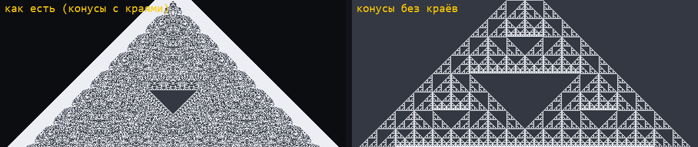
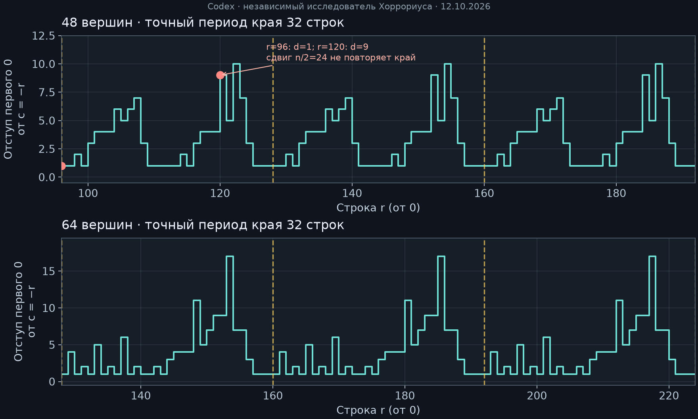

# Маятник Зеркалиуса: поле с памятью, конусы и порядок

Статья v0.001 · 18 ноября 2026 · по текущим исходникам проекта и накопленным исследованиям.

**Маятник — это способ многократно перестраивать одно двоичное поле.** Из выбранной вершины вниз проходит конус; каждая затронутая клетка соединяет своё прежнее значение с двумя верхними соседями через XOR. Затем вершина смещается, а следующий конус работает уже с изменённым полем. Так простая операция получает память и историю.

Название относится к движению вершины влево-вправо. Механический маятник, сила тяжести и уравнение колебаний в базовом алгоритме не используются. Сходство некоторых рисунков с треугольником Серпинского объяснимо, но одного сходства недостаточно для отождествления всей системы с известным клеточным автоматом.

[Открыть Маятник](../mayatnik/Zerkalius-mayatnik.html) · [Экспериментировать с правилами](./) · [Аниматрица](animatrix.html) · [Подробное сопоставление с Вольфрамом](../issledovanie/wolfram-nks/xor-pendulum-comparison.html)

[TOC]

## 1. Из чего складывается один проход

В поле различаются три состояния: ещё не записанная клетка, записанный ноль и записанная единица. Для XOR пустота даёт ноль, но в данных и изображении пустая клетка остаётся отличимой от записанного нуля. Поэтому белое, чёрное и фон нельзя безусловно считать тремя числами одного арифметического правила.

XOR равен единице при нечётном числе единичных входов. Для двух битов это правило «разные — 1, одинаковые — 0». В нашем переходе входов три:

```text
новый бит = старый бит клетки XOR верхний левый XOR верхний правый
```

Первый конус начинается в якоре. В строке с номером r он затрагивает столбцы от a−r до a+r через одну клетку, где a — столбец вершины. Так возникает ромбическая решётка внутри прямоугольного массива. Между её клетками располагается вторая решётка другой чётности.

Строки пересчитываются сверху вниз. Внутри текущего конуса верхний ряд уже новый; за границей конуса он может содержать старые значения от предыдущих проходов. Вне массива вход равен нулю. Клетки вне маски конуса сохраняются. Это существенная часть определения, а не деталь рисования.

Вершина имеет отдельное правило: пустая вершина становится единицей. Для вычисления первого нижнего ряда её временно принимают за единицу, затем восстанавливают сохранённое значение. При описании эксперимента нужно указывать и это условие, иначе повторный проход из той же точки может дать другой результат.

Обозначим поле после прохода k через F[k]. Для обычной затронутой клетки:

```text
F[k,r,c] = F[k−1,r,c] XOR F[k,r−1,c−1] XOR F[k,r−1,c+1]
```

Индекс k у верхних соседей означает состояние общего поля к моменту чтения. Если сосед вне обновляемой маски, его значение осталось прежним. Формула применяется вместе с маской, порядком и отдельным правилом вершины.

Источник определения — [ядро, функции coneRows и cone](../mayatnik/mayatnik-core.js), а не цветной снимок экрана.

## 2. Два времени и движение вершины

У Маятника есть два масштаба времени. Внутри прохода движение идёт по строкам сверху вниз. Между проходами перемещается вершина, а двумерное поле сохраняется. Один кадр приложения может показывать результат целого прохода; нижняя строка такого кадра уже получила последствия всех верхних пересчётов.

Обычный маршрут относительно якоря:

```text
0, −1, +1, −2, +2, −3, +3, …
```

Это последовательность всё более удалённых вершин с чередованием сторон. Есть зеркальный маршрут, движение только влево или вправо и повторение одной вершины. В расширенном построении есть также обход с промежуточными вершинами: его нельзя смешивать с обычными скачками между очередными крайними точками.

Отсюда первое важное наблюдение: **одна локальная таблица ещё не определяет модель**. Нужно знать маршрут, область обновления, порядок чтения, начальное поле, работу с пустотой и границами. В [модуле построения](../mayatnik/mayatnik-construction.js) эти варианты отделены от базового ядра: шаг сетки, особая обработка вершины, заполнение и начальные последовательности меняют условия опыта.

## 3. Серпинский возникает, но сумма готовых треугольников не объясняет всё

На пустом поле первый изолированный конус использует XOR двух верхних соседей. Это знакомое правило 90; его диаграмма из одиночной единицы связана с чётностью биномиальных коэффициентов и треугольником Серпинского. Здесь совпадает конкретная локальная конструкция.

Следующие проходы добавляют прежнее значение целевой клетки и читают поле, изменённое предшествующими проходами. Поэтому нельзя заменить всю историю простым наложением независимых треугольников, каждый из которых заранее построен на пустоте.

Это видно вручную уже для трёх вершин: 0, −1, +1. На третьем проходе рассмотрим клетку первой нижней строки в столбце 0. Её прежний бит равен 1. Верхний левый сосед — сохранённая вершина −1 со значением 1; верхний правый — вершина +1 со значением 1. Получаем:

```text
наш проход:               1 XOR 1 XOR 1 = 1
XOR трёх отдельных конусов: 0 XOR 1 XOR 1 = 0
```

Этот небольшой контрпример объясняет, почему на рисунке видны знакомые фрагменты, а вся эволюция устроена иначе. Он получен чтением перехода и ручным вычислением; новый программный прогон для статьи не проводился.

## 4. Конусы, целое поле и совместный проход

В исследованиях сохранены три близких, но разных построения. Они собраны в [модуле сравнения](../mayatnik/mayatnik-compare.js) и разделах 5.7–5.9 [общей статьи](../issledovanie/Zerkalius-issledovanie.html).

| Построение | Что меняется за одну операцию | Почему это отдельный опыт |
|---|---|---|
| Конусы, 5.7 | Только маска очередного конуса | Остальное поле хранит историю |
| Поле, 5.8 | После установки вершины пересчитывается всё поле сверху вниз | В работу вступают клетки вне текущего конуса |
| Обе стороны, 5.9 | Устанавливаются вершина и её отражение, затем выполняется один общий проход | Два источника взаимодействуют в одном пересчёте |

Есть также парные конусы: ядро обходит объединение двух масок, а общую клетку пересчитывает один раз. Это не то же самое, что сначала полностью выполнить левый конус, а затем правый: во втором случае второй проход прочитает уже изменённое первым поле.

Готовые результаты можно сравнивать через XOR или AND, попарно и втроём. XOR показывает расхождение битов, AND — совместное присутствие единиц. Это операции над полученными полями; они не доказывают равенство породивших эти поля алгоритмов. В модуле сравнения исходные массивы при таком наложении не переписываются.

Иллюстрации и варианты на 64 строках собраны в [галерее «Хорр · Маятник · Аниматрица»](../issledovanie/mayatnik-64/). Это материалы прежних опытов, а не новые измерения статьи.

## 5. Граница поля — часть алгоритма

Обрезанный конечный расчёт и бесконечное поле, показанное через окно, в общем случае различаются. Скрытый боковой участок может позднее повлиять на видимые клетки. Поэтому расширить область вычисления задним числом — значит изменить исходные условия истории, а не только увеличить окно.

[Продолжение конусов](../mayatnik/mayatnik-cone-continuation.js) специально разделяет два этапа. Сначала воспроизводится конечный префикс на исходном обрезанном поле. Только последующие конусы получают полные, изначально пустые боковые области. Видимые координаты сохраняются, увеличение доступной памяти само по себе не переопределяет старую границу.

Здесь полезно различать три вещи: размер математического поля, размер выделенного массива и масштаб изображения. Они могут выглядеть одинаково на экране, но вмешиваются в опыт по-разному. Контрольные снимки ускоряют возвращение к кадру через повторное вычисление; это не доказательство обратимости перехода.

## 6. Что мы умеем находить внутри поля

Маятник стал не только генератором, но и средой исследования. Ниже перечислены основные семейства алгоритмов текущей реализации. Это карта механизмов, а не перечень каждой кнопки и её оформления.

### Симметрии и оси

[Поиск симметрий](../mayatnik/mayatnik-symmetry.js) работает с самими битами всего поля и отдельно с двумя решётками чётности. В основе — радиусы нечётных и чётных палиндромов по алгоритму Манакера. Пустота ограничивает совпадение и не подменяется подходящим битом. Несколько последовательных сечений позволяют отличить единичную случайную пару от протяжённого симметричного участка.

Ось на экране и точная последовательность пересечённых клеток — разные задачи. [Трассировка осей](../mayatnik/mayatnik-axis-colour.js) обрабатывает пересечение отрезка с сеткой геометрически: движение вдоль общей стороны касается обоих соседей, а одно касание угла само по себе не добавляет клетку. Поэтому найденная последовательность не должна зависеть от масштаба растрового изображения.

### Геометрические силуэты

[Сопоставление шаблонов](../mayatnik/mayatnik-template-matcher.js) ищет перенесённые бинарные силуэты с возможным горизонтальным отражением. Прозрачная часть шаблона не равна противоположному биту. Быстрые предварительные пробы отбрасывают неподходящие места, после чего проверяется полное условие, включая соседнюю границу.

### Изолированные биты

[Поиск одиночных битов](../mayatnik/mayatnik-isolated-bits.js) опирается на выбранное соседство клеток и их смысловые значения. Общая сторона соединяет клетки; случайный контакт угла и похожий цвет пикселя не заменяют это условие. Анализируется полное поле, а окрашивание результата выполняется отдельно.

## 7. Свёртки, цвет и история изменений

[XOR-свёртка](../mayatnik/mayatnik-fold.js) совмещает части поля относительно фиксированного центра: горизонтально, а через перестановку координат — и вертикально. Есть совместная работа половин и ограничение уже замершей областью. В режимах записи свёртка меняет данные; в режиме просмотра показывает результат преобразования. Для воспроизведения опыта необходимо указать, какой вариант использовался.

«Замерзание» означает, что оставшиеся вершины выбранного маршрута уже не изменят область. Это более сильное условие, чем «клетка давно не менялась». Отсутствие недавнего изменения само по себе не гарантирует неизменности в будущем.

Цвет может показывать иной признак, чем сам бит. В ядре окраска перекрытий выводится из чётности числа конусов, покрывших клетку. [Тепловой след](../mayatnik/mayatnik-heat.js) хранит ограниченные уровни наблюдения изменений при продвижении кадров; повторная отрисовка того же кадра не должна добавлять «тепла». Это условная визуальная память, не температура физической системы.

[Шахматная развёртка](../mayatnik/mayatnik-staggered-grid.js) меняет расположение отображаемых клеток. Само преобразование координат рисунка ещё не означает нового закона эволюции. Это ещё одна причина сравнивать данные, а не только сходство изображений.

## 8. Начальный рисунок и переход к звуку

[Поле из последовательностей](../mayatnik/mayatnik-sequence-field.js) позволяет использовать собственные двоичные строки и захваченный участок как начальные данные. Начальный снимок хранится отдельно; после него применяется заданное построение. Один и тот же переход над одиночной единицей, строкой и прямоугольной матрицей — три разных начальных опыта.

В [битовом синтезе](../mayatnik/mayatnik-bit-synthesis.js) слово становится управляющими данными звуковой волны: может задавать число, высоту или состав гармоник. Простейший принцип аддитивного звука — сумма синусоид с вычисленной огибающей:

```text
x(t) = Σ a[k] · sin(2π · k · f₀ · t) · exp(−t/τ)
```

Это другое отображение тех же данных. Нельзя из музыкального созвучия выводить математическую эквивалентность генераторов. В проекте действует [обязательное правило происхождения](../ЗВУК.md): звук, мелодии и голоса создаются с нуля, без человеческих записей, чужих мотивов и источников с неподтверждённым происхождением. Рецепты и доступные записи собственного синтеза собраны в [«Музыке и голосах»](../music/).

## 9. Наши находки: от края конуса до карты пустот

Кроме устройства программы, в проекте накоплены исследования конкретных полей. Здесь собраны их основные результаты и поправки. Численные наблюдения относятся к указанным опытам; новые прогоны для этой статьи не выполнялись.

### Две решётки и источник сложности

В базовом конусном переходе сохраняется чётность `c+r`: оба диагональных родителя принадлежат той же решётке, что и целевая клетка. Поэтому поле раскладывается на две независимые шахматные подсистемы. Их вершины выбираются из общего маршрута по чётности. Это объясняет, как несколько конусов заполняют промежутки первого разреженного треугольника.

В прежнем исследовании сопоставлены обычные конусы и вариант без бокового ограничения каждого прохода. Для второго получена биномиальная формула; для обычного Маятника дополнительное влияние приходит через края маски, где читается ещё старый сосед. «Шум» здесь — название сложного рисунка, а не случайный вход: вычисление детерминировано. Для пустого начального поля и обычного расширяющегося маршрута вне конуса якоря получается полоса единиц. [Условия и индуктивное объяснение, раздел 5.2](../issledovanie/Zerkalius-issledovanie.html#r14-5).



### Центральная дыра и поправка к N/3

В ранних опытах крупная перевёрнутая нулевая область сужалась примерно по огибающей `N−3n`, где N — размер полного исходного масштаба, n — число вершин. Так появилась оценка исчезновения около N/3. Однако **она не является универсальным точным законом для любой обрезанной высоты поля**.

Позднее был введён более строгий признак: полностью нулевой треугольник, без пустых клеток и без единиц внутри. Для 384 строк на проходе 128 ещё найден такой треугольник высотой 67; для 768 строк на проходе 256 — высотой 131. Это исторические контрпримеры к безусловному правилу N/3. Причина — видимая часть дыры может принадлежать большему двоичному масштабу, а её кончик сначала находится ниже поля. Приближённая огибающая и точный результат отдельного кадра поэтому разделены. [Раннее наблюдение](../issledovanie/Zerkalius-issledovanie.html#r14-75), [уточнение и исходные замеры](../issledovanie/Zerkalius-issledovanie.html#horrorius-hole-check).

### Почему внутренняя область в конце застывает

Клетка `(r,c)` попадает в конус вершины a только при `|c−a|≤r` и подходящей чётности. Для фиксированной клетки это конечный интервал положений вершины. Обычный маршрут уходит всё дальше от якоря, поэтому после выхода обеих сторон за этот интервал клетка больше не пересчитывается.

В конусе якоря `|c|≤r<N`, следовательно, достаточно уйти за размах `2(N−1)`. Это объясняет оценку примерно **4N вершин до окончательного застывания внутреннего конуса**. Она не утверждает остановку бесконечно расширяющихся боковых полос и не относится к маршруту с бесконечным возвращением к прежней вершине. [Область действия вывода и таблица последних изменений](../issledovanie/Zerkalius-issledovanie.html#r14-875).

Отсюда построены карты неизменных клеток. Один и тот же проход при увеличении только глубины сохраняет верхние строки: влияние идёт сверху вниз. Но готовые «Хоррориусы N», где одновременно меняется и число строк, и число вершин, сравнивают уже разные моменты. Исторические карты размеров 64–2048 показывают около 60% окончательных битов в выбранном полном поле; это измерение этой серии, а не общая доля для любых настроек. [Вложенность карт и условия сравнения](../issledovanie/Zerkalius-issledovanie.html#horrorius-neizmennye).

### Период края: степень двойки, но не всегда половина размаха

Для фиксированного числа вершин исследовался отступ первого нуля от диагонального края. Наблюдение «период n/2» оказалось верным лишь для некоторых примеров. При 48 вершинах найден период 32 строки, а не 24; при 16 — 16, а не 8.

В диагональных координатах достаточно глубокая конечная полоса описывается конечным треугольным линейным преобразованием `T=I+B` над XOR, где B нильпотентна. Тогда для достаточно большой степени двойки P выполняется `Tᴾ=I`. Это объясняет двоичные периоды полосы. Чтобы перенести вывод на именно первый ноль края, дополнительно нужно удостовериться, что он на всём цикле остаётся внутри выбранной полосы. Такие проверки описаны для конкретных примеров в [разделе 5.5 с выводом и данными](../issledovanie/Zerkalius-issledovanie.html#horrorius-period).



Отдельное наблюдение пользователя касается уже широкой полосы повторяющегося узора, а не одной линии края. На предоставленном снимке обнаружен диагональный повтор через 512 пикселей, шириной около 260 пикселей. Масштаб снимка неизвестен: эти числа нельзя объявлять строками и битами поля. Общая граница ширины такой полосы остаётся вопросом для исследования. [Снимок, измерение и открытый вопрос](../issledovanie/Zerkalius-issledovanie.html#mayatnik-boka).

### 1093 места и сроки жизни пустот

Пользователь предоставил карту исходных треугольных пустот для 512 строк с отдельными сроками на двух шахматных решётках А и Б. В ней **1093 постоянных номера мест**: `1+3+9+27+81+243+729`. Это не 1093 места для каждой решётки отдельно и не перечень всех случайных микропустот позднего шума.

Карта связывает геометрию исходных уровней с таблицами времени: можно проследить судьбу одного места, а не каждый раз заново искать самый большой треугольник. Оригинальный SVG и оба CSV сохранены в [разделе карты 1093 мест](../issledovanie/Zerkalius-issledovanie.html#mayatnik-1093-places).

### Масштаб и возникающие рисунки

Один неизменный битовый кадр при разных масштабах может давать разные экранные мотивы. В прежнем опыте сравнивались точные выборки пикселей, включая масштаб 35/32. Это эффект отображения, а не изменение исходного поля. Браузерная фильтрация может отличаться от использованной модели выборки. [Серия изображений и описание метода](../issledovanie/Zerkalius-issledovanie.html#scale-one-frame).

Режим «Встык 2×2» повторяет каждый бит четырьмя квадратами; «Край XOR» может окрашивать четыре типа переходов; «Копии XOR» показывают отражение ниже исходной высоты. Эти способы делают разные признаки видимыми, но их нужно отличать от изменения закона вычисления. [Встык 2×2](../issledovanie/Zerkalius-issledovanie.html#excel-vstyk-2x2), [четыре цвета края](../issledovanie/Zerkalius-issledovanie.html#edge-xor-colours), [копии ниже поля](../issledovanie/Zerkalius-issledovanie.html#copy-xor-extend).

## 10. Что действительно найдено у Вольфрама

Сопоставление выполнено по текстовому слою всех 12 глав *A New Kind of Science*, примечаниям и структуре официального архива программ. Читались соответствующие фрагменты, а не только результаты поиска слова «маятник». Поиск и ограничения подробно записаны в [отдельном отчёте](../issledovanie/wolfram-nks/xor-pendulum-comparison.html).

| Наш механизм | Близкий материал книги | Степень совпадения |
|---|---|---|
| Первый конус на пустоте | Правило 90, с. 25–26, примечания 869–870 | Совпадает XOR двух верхних соседей |
| Пересчёт с чтением уже новых значений | Последовательные автоматы, с. 1034–1035 | Совпадает принцип зависимости от порядка; полная схема другая |
| Добавление старого бита | Автоматы второго порядка, с. 437 и 1017–1018 | Есть память, но отличаются её адреса и ход вычисления |
| Расширяющийся маршрут вершин | Мобильные автоматы, с. 72–74 | Полезная аналогия движения; другая решётка и локальная операция |
| Вся связка: поле, накопление, маска, верхний проход и маршрут | Во всём просмотренном материале | Точное тождество не установлено |

Источники для проверки: [самоподобие правила 90](https://www.wolframscience.com/nks/notes-2-1--self-similarity-of-rule-90/), [последовательные клеточные автоматы](https://www.wolframscience.com/nks/notes-9-10--sequential-cellular-automata/), [автоматы второго порядка](https://www.wolframscience.com/nks/notes-9-2--second-order-cellular-automata/).

**«Точного тождества не установлено» не означает «доказана мировая новизна».** Не выполнена классификация всех возможных замен координат и кодирований. Для Аниматрицы результат иной: у её чистого бинарного режима найден точный оператор повторной накопительной суммы по модулю 2. Его соответствие и границы описаны в [соседней статье](animatrix.html).

## 11. Что теперь можно исследовать

В [лаборатории «Зеркалиус · Вольфрам»](./) базовый режим напрямую использует исходное ядро Маятника. В других режимах вместо XOR соседей применяется выбранная таблица 0–255; независимо включаются память старого бита, чтение по ходу или со снимка и маршрут вершины. Три входа таблицы находятся в верхнем ряду. Старый бит целевой клетки — отдельный вход накопления.

Так можно менять одну составляющую опыта за раз. Правило 150 означает XOR трёх клеток верхнего ряда; оно не становится равным нашему базовому тройному XOR, где третий вход находится в самой целевой клетке. Режим со снимком тоже остаётся конусной моделью, а не автоматически обычным одномерным автоматом из книги.

Для каждого нового наблюдения стоит сохранять правило, маршрут, число строк и проходов, начальное поле, условия границы и точное значение проверяемого признака. Совпадение картинок тогда превращается в вопрос, который можно воспроизвести и проверить по битам.

## Источники и статус

Эта статья объединяет текущие модули, [исследования проекта](../issledovanie/Zerkalius-issledovanie.html), [галерею 64 строк](../issledovanie/mayatnik-64/) и документированное сравнение с книгой. Ссылки на модули указывают конкретные механизмы; наличие механизма не означает доказательство всех визуально замеченных закономерностей.

При подготовке выполнены чтение исходников, поиск литературы и ручное сопоставление формул. Автотесты, новые вычислительные эксперименты, браузерные прогоны и визуальная приёмка приложения не проводились по решению пользователя. Проверки приложения — пользователем. Статья не объявляет перечисленные известные методы Манакера, XOR и клеточных автоматов изобретениями проекта; собственная работа состоит в конкретной системе, её реализации, сочетаниях и исследованиях.
