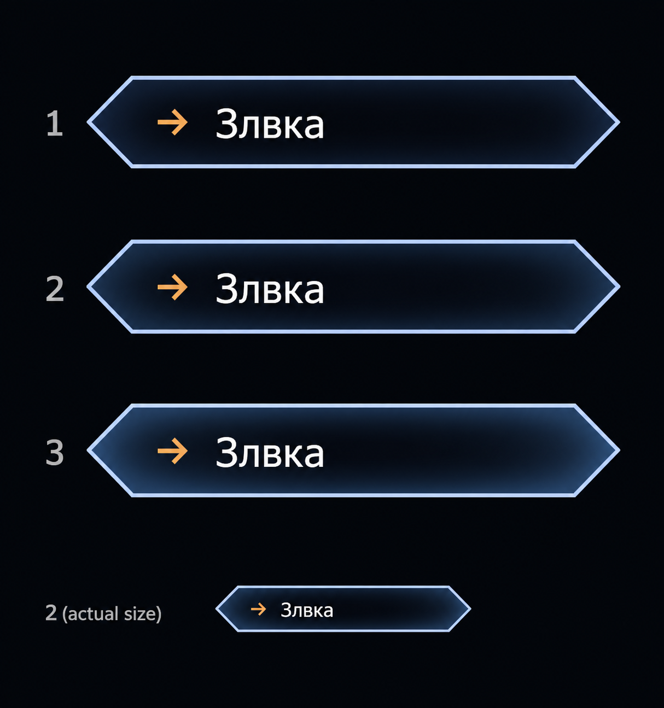

# Единый стандарт кнопок Zerkalius

Версия 92 · 2026-10-28 · задачи КНП-001, КНП-002, КНП-004, КНП-005, КНП-006, КНП-007, КНП-009, КНП-010, КНП-011, КНП-012, КНП-013, КНП-014, КНП-015, КНП-016, КНП-017, КНП-018, КНП-019 и ХАБ-003.

Свод актуальных требований пользователя из переписки, сверенный с правилами проекта и существующими компонентами. Это норматив для последующего приведения интерфейсов к стандарту и создания новых кнопок. Запись правила не означает, что весь существующий код уже ему соответствует.

## Область и приоритет

- Стандарт распространяется на кнопки, заголовки групп, части составных кнопок, списки вариантов, ползунки и пульты активных страниц.
- Позднее явное уточнение пользователя заменяет раннее требование только по соответствующему вопросу. Специальное правило действует в своей области, остальные общие требования сохраняются.
- Предыдущая просьба «все кроме свитчер» сохраняет запрет на самостоятельную переделку Свитчера. Замороженный `Zerkalius-hub-konus.html` также не переделывать. Эта документационная задача сама не запускает миграцию страниц.
- Инструкции по расчётам, сохранению пользовательских данных, версиям и координации сохраняют силу. Меняя оформление, не менять функции кнопок.
- Источники в таблицах: **Ч** — явное требование из этой переписки; **П** — ранее действовавшее правило проекта; **К** — числовой ориентир существующего компонента, а не отдельная числовая команда пользователя; **С** — согласование пересекающихся требований.

## Иллюстрации

Ниже к таблицам добавлены семь эталонных схем; все обновлены под градиент В07 (витрина v1.001). Они показывают требуемый стандарт; это не заявление, что все страницы уже переделаны. Кнопки нарисованы из HTML/CSS с фиксированными размерами, без художественной перерисовки. Подписи кнопок проходят через действующий модуль сокращения Хаба.

Изображения сохранены в масштабе 2× для чёткости. **Числа на схемах — CSS px**, а не размер картинки в пикселях. Значки в схемах условно обозначают команды; в приложениях использовать общие значки по В14. Цвет группы может различаться, правила состояния одинаковы.

[Открыть исходную витрину](knopki/standart/index.html) · [Витрина на сайте](https://1001100.online/knopki/standart/index.html). PNG лежат рядом с HTML в `knopki/standart/`. При изменении правила обновлять соответствующую схему и подпись вместе.

## Внешний вид и размеры

| ID | Что | Обязательное правило | Основание / проверка |
|---|---|---|---|
| В01 | Форма | Низкий шестиугольник с острыми боками; составные части и края групп продолжают тот же зубчатый контур. Прямоугольные и скруглённые карточки не заменяют стандартные кнопки. | Ч: «всё в зубцах»; П: «Вариант А». |
| В02 | Общая конструкция | Использовать общие детали `_js/grozd.js` / `grozd.css`: `gz-hx`, для частей — `gz-pair gz-split`. Не создавать отдельный несовместимый стандарт на каждой странице. | П; существующие адаптеры страниц пока сохраняются, их перенос — отдельный этап. |
| В03 | Размер обычной кнопки | Все обычные кнопки одного стандартного размера, включая нижние элементы, варианты списков и заголовки групп. Длина надписи не увеличивает кнопку. Базовый ориентир общей системы — **120 × 24 CSS px**. | Ч: «нижние больше чем надо»; К: `--gz-w:120px`, `--gz-h:24px`. Это не физические пиксели монитора. |
| В04 | Исключения размера | Числовой пульт и транспорт могут занимать согласованную ширину из стандартных частей. Две половины вместе занимают одну кнопку. Для рамки кадра действует ПЛ05. Такие исключения не увеличивают обычные кнопки списков. | Ч, С. Отдельная ширина требует назначения, а не подгонки под длинный текст. |
| В05 | Отступы | Единый вертикальный зазор в группах и списках — **2 CSS px**, в толщину обводки выбранной кнопки. Не добавлять двойной отступ на границе секций; проверять начало, середину и низ каждого столбца. **Между соседними группами и столбцами списков** — тот же зазор 2 px, но считается **от подложки до подложки**: при выступе подложки 2 px острия соседних кнопок стоят в 6 px, шаг столбцов кнопок 120 px — **126 px**. | Ч: «отступы ... много где разные»; К: поздние правила `mayatnik-menu.css`; Ч (КНП-015): «приближать группы … и у списков … до отступа межстрочного», «от фона». |
| В06 | Размер при взаимодействии | Наведение, выбор и нажатие не меняют размеры, положение и интервалы кнопок. Толщина рамки меняется внутри существующего контура. **Текст кнопок, заголовков, половин, ползунков, бегунков и пультов не выделяется** — ни протяжкой, ни двойным щелчком, ни долгим касанием (`user-select: none`); поля ввода и подсказки этого не касается. | П, С.; Ч (КНП-019, 2026-10-23): «отключи выделение текста кнопок и бегунков — сразу в правила запиши». |
| В07 | Постоянный ровный фон | Внутренний фон кнопки — **ровный, без градиента** (ориентир `#1b2430`); не меняется от наведения, включения и удержания; состояние показывается обводкой. Текст без свечения. Смена выбранного образца цвета — изменение значения, а не подсветка фона. Градиентов нет и у подложки (В12). | Ч (2026-10-23): «убери градиент со всех кнопок» — заменяет выбранный ранее эскиз «тёмный центр, светлее к границам»; сохраняет «без фона изменяемого … только обводка». |
| В08 | Текст без свечения | Убрать свечение, тень и подсветку текста при наведении и выборе. Не осветлять надпись вместо рамки. Проверять обычные кнопки, половины, стрелки и заголовки. | Ч: «убери везде подсветку при наведении текста». |
| В09 | Цвет рамки | Наведение использует цвет включённого состояния соответствующей группы. У каждой части составной кнопки своя рамка. | Ч, П. |
| В10 | Толщина рамки | Наведение / видимый клавиатурный фокус — тонкая рамка; включение / выбор — толще; удержание нажатия — ещё толще. Числовой ориентир: **1 / 2 / 3 CSS px** соответственно. **Рамка наведения обводит только боковые углы** (острия слева и справа), без верхней и нижней граней; выбор и удержание — полной рамкой (Ч 2026-10-23: «при наведении пусть не все границы обводят, а только боковые углы»). | Ч задаёт порядок толщин; К — текущая реализация v0.439. |
| В11 | Приоритет состояний | Удержание выше выбора, выбор выше наведения. Наведение на уже включённую кнопку не делает её рамку тоньше. При отпускании возвращается её настоящее состояние. **Кнопка или половина, выключенная щелчком мыши, не показывает даже рамку наведения 1 px, пока указатель не уйдёт с неё**; клавиатурный фокус сохраняется. | С из В10; Ч (КНП-018): «когда кнопку нажимаю и она становится отключённой, … не показывает и 1 px обводки». |
| В12 | Подложка группы | Подложка нужна за **всей** группой: сверху, снизу, сбоку, за неактивными элементами и нижними ползунками. Прямоугольного фона вокруг нет. У раскрытой группы или списка подложка заполняет всё между верхней и нижней скобками Р13 и сходится с их концами. Заливка — **ровная, без градиента**, тёмная (`#0e1116`), темнее фона кнопок В07; так же у подложки закрытых групп (Ч 2026-10-23: «убери градиент и с подложки групп и списков»). | Ч: «вверху ... есть фон ... внизу нет», «всё в зубцах»; Ч (КНП-015, витрина v1.020): «круговым градиентом из центра светл в черн … до скобок-границ», «ещё на 25% убавь», «ок». |
| В13 | Бока подложки | Бока подложки — **мелкие тупые зубцы**: острие на **2 px** (= межкнопочный зазор) снаружи острия каждой кнопки, впадина напротив середины зазора на **6 px** внутрь от линии остриёв. Сверху и снизу бок сходится с концом скобки Р13. Проверять крайние столбцы и длинные группы. Заменяет прежний выступ 1 px. | Ч (КНП-015): «по бокам зубчатая, отступ от кнопок наружу такой же, как между кнопок», эскиз «вот так» (витрина v1.017); прежнее Ч «толщина в 2 …», К v0.438 — заменены. |
| В14 | Значки и типографика | Для обычной команды — понятный общий значок и короткое название; одинаковый смысл имеет одинаковый значок на всех страницах. Чисто графические и числовые половины допускаются там, где пользователь их выбрал. У кнопки со списком справа сохранять внешний шеврон и добавлять **ещё один шеврон внутри**, с отступом от внешнего края и меньшей высотой; он не перекрывает подпись и не перехватывает нажатия. Основной шрифт берётся из общего компонента; моноширинные подписи существующих панелей SOL_PLATES сохраняют локальное правило. **Значок окрашен цветом своей группы** (Ч 2026-10-23: «цвет значков в цвет группы»). | П, С; палитра — исключение по Ч, см. КН02. |
| В15 | Телефон | Сохранять пригодные для касания элементы и доступ к спискам. Не превращать короткую надпись в крошечную мишень. Изменения плотности согласовывать общей раскладкой; одинаковые соседние кнопки не получают случайно разные размеры. | П: `zazerkalius/AGENTS.md`. Отдельный новый размер мишени пользователь числом не задавал. |

### Выбранный фон: уточнение 2026-10-23

Пользователь выбрал эскиз ниже: **тёмная середина → плавное осветление к границам, без центральной линии**. Позднейшие варианты со светлой серединой и линией не выбраны. Объём — постоянное свойство поверхности; наведение, включение и удержание по-прежнему обозначаются обводкой В09–В11.

Это выбранный художественный эскиз поверхности, а не чертёж размеров: обозначение «actual size» на нём не является измерением CSS px. Точные RGB и степень контраста из трёх показанных пользователем отдельно не выбраны. Габариты, зазоры и толщина обводок задаются В03–В13. Все семь числовых схем ниже и их HTML-источник обновлены: поверхность обычных кнопок, составных пар и ползунков имеет тёмный центр и более светлые края. У пары градиент общий на обе половины; выбор и наклон разделителя его не меняют. Цветовые образцы палитры сохраняют свои значения. Реализация в продуктовых приложениях — отдельный этап.

### Пример: состояния кнопки

### Пример: размеры, отступы и подложка

Схема ниже сохранена как иллюстрация прежних размеров. С версии 12 актуальный зазор — 2 px, боковой выступ — 1 px; рабочий образец — [интерактивная витрина](knopki/standart/#appearance).

## Расположение, раскрытие и перекрытие

| ID | Что | Обязательное правило | Основание / проверка |
|---|---|---|---|
| Р01 | Столбец группы | Основная раскладка группы — одна кнопка в строке, один столбец; прежние двухколоночные «соты» не являются стандартом. | Ч: «все группы ... в один столбец». |
| Р02 | Столбцы — по вложенности | **Группа раскрывается только вниз под своим заголовком или вверх над ним** (вверх — когда снизу не хватает места); **вбок группы не раскрывать** ни при каком положении рейки. **Раскрытая группа сдвигает остальное:** заголовки и группы ниже (при раскрытии вверх — выше) по той же рейке отодвигаются на высоту раскрытого столбца и возвращаются при закрытии; поверх соседей группа не ложится (Ч 2026-10-23: «при этом сдвигая остальное»). **Один столбец — один уровень вложенности:** все кнопки группы стоят в своём столбце, сколько бы их ни было; **делить столбец на два и более по количеству кнопок нельзя.** Следующий столбец появляется только для следующего уровня — списка вариантов кнопки (Р04). Если столбец не помещается по высоте, он прокручивается целиком, а не переносится. | Ч (2026-10-23): «в столбце ограничение не по количеству, а по вложенности, нельзя делить столб на 2 столбца». Заменяет прежнее «5–7 кнопок, максимум 7, остальные — во втором столбце».; Ч (2026-10-23): «все заголовки раскрывай только вниз или вверх, не вбок» — заменяет «слева раскрывать группу вправо». |
| Р03 | Группа и список вариантов | Различать раскрытие группы под её заголовком и дополнительный список вариантов отдельной кнопки. В верхнем/нижнем положении обычная группа сохраняет столбец от своего заголовка; **список вариантов кнопки открывается сбоку** по Р04. | С: снимает неоднозначность раннего «под кнопкой». |
| Р04 | Варианты сбоку | В верхнем и нижнем положении кнопок списки вариантов открывать вправо или влево от их столбца; справа по возможности, слева при недостатке места. Не накрывать нижнюю часть того же столбца раскрытием строго вниз. | Ч: позднее «верни списки влево или вправо от столбца». |
| Р05 | Граница экрана | Направление и высоту раскрытия подбирать по свободному месту; сохранить стандартный размер кнопок и доступ к продолжению списка. Не оставлять недоступные варианты за краем окна. | П, С; при тесном экране допустима прокрутка контейнера. |
| Р06 | Перекрытие | **Перекрытые элементы не скрывать.** Раскрытая группа или список ложится поверх соседних групп; ни чужая группа, ни её отдельные кнопки или заголовок не прячутся. В Маятнике область пересечения нижней группы частично затемняется полупрозрачным чёрным слоем; свободная часть остаётся прежней, управление и раскладка сохраняются. | Ч (2026-10-23): «убери скрытие перекрывающихся». Уточнение 2026-10-24: «при наложении на другие группы затемняй частично область перекрытых». Заменяет прежние «всю другую группу скрывай» и «скрывать только в этом столбце то, что перекрывает». |
| Р07 | Восстановление | Перекрытие не удаляет и не пересохраняет раскладку; после закрытия списка, сворачивания или перемещения всё остаётся на прежних местах с прежним состоянием. | С, П о сохранённых данных; Р06 v21. |
| Р08 | Остальные кнопки своей группы | При открытом списке одной кнопки затемнять остальные кнопки её группы; активную кнопку и варианты сохранять читаемыми. После закрытия затемнение снимать. Затемнение не означает отключение функции. | Ч: «затемняй остальные кнопки группы». Текущая opacity .25 — реализация, не отдельная команда пользователя. |
| Р09 | Число открытых групп | Обычное открытие временной незакреплённой группы следует общему режиму «одна активная группа». Не сбрасывать уже сохранённые закрепления ради этого правила; при наличии нескольких закреплённых групп действуют Р06–Р07. Закрепление управляется небольшим значком в самом заголовке группы, а не отдельной кнопкой в конце списка. Нажатие на этот значок не запускает перетаскивание и не срабатывает как обычный щелчок по заголовку; состояние закрепления сохраняется после перезагрузки. | П: «Вариант А»; С с закреплением и раскладкой. |
| Р10 | Перемещение групп | Заголовок позволяет перемещать группу и менять порядок/доступное место закрепления. Специальная группа не должна терять эту возможность. Шапка и её кнопки не срабатывают случайно при перетаскивании. В Маятнике сверху только одна полоса приёма кнопок: второй и следующие ряды не создаются, отпускание ниже полосы не добавляет новый ряд. При нехватке ширины продолжение доступно горизонтальной прокруткой. | П; Ч: сделать «Хорр» обычной перемещаемой группой. |
| Р11 | Чистая геометрия | Прямоугольные контейнеры, лишние рамки, неполная подложка и разные вертикальные отступы проверяются во **всех** группах, включая длинные и перенесённые к другому краю. | Ч: повторные требования «у всех групп». |
| Р12 | Сворачивание заголовка в ромб | Правый щелчок по заголовку меню или группы сворачивает только заголовок в ромб со значком; повторный правый щелчок возвращает обычный заголовок. Обычный щелчок по ромбу открывает и закрывает ту же группу или меню. Сворачивание не меняет раскрытие, закрепление, порядок и значения; компактное состояние сохраняется после перезагрузки. Подсказка и доступное имя остаются полными; перетаскивание и безопасное перекрытие продолжают работать. В Маятнике правый щелчок сворачивает в ромб любую кнопку, включая «?», повторный возвращает её; обычное действие и сохранение после F5 остаются. | Ч: «правый клик по заголовкам меню сворачивает их в ромб», «добавь» (2026-10-23); существующее независимое mini в mayatnik-menu.js. |
| Р13 | Контур раскрытого списка | У раскрытой группы или списка после отпускания нажатия цветом группы выделена только верхняя половина контура заголовка: от середины высоты по верхнему краю до середины другой стороны. Нижняя половина такого же контура показана под последней видимой кнопкой списка, включая нижние элементы группы. Если список раскрыт в другом столбце, над его первой кнопкой дополнительно показывать отдельную верхнюю полуобводку, симметричную нижней под последней кнопкой. Оба контура открытые: горизонтальную линию через середину не добавлять. Наведение и фокус не возвращают полную яркую рамку раскрытому заголовку. Во время удержания действует В10–В11; после отпускания возвращаются половинные контуры. Закрытый заголовок сохраняет обычную рамку; правило действует также для заголовка-ромба по Р12. **У заголовка группы, раскрытой вниз** (кнопки идут столбцом под ним), **нет собственного фона и рамки** — за ним виден градиент подложки В12. У группы, раскрытой вверх, так же: столбец над заголовком, заголовок без своего фона, скобки на внешних краях столбца. Вбок группы не раскрываются (Р02 v22); заголовок кнопки со списком вариантов сохраняет обычный фон (Ч 2026-10-23: «это не списки, прозрачными только те, что вниз, только когда открывают»); верхняя скобка лежит на его верхней границе и рисуется слоем группы, а не внутри кнопки (кнопка обрезает своё содержимое по шестиугольнику). Нижняя скобка — под последней кнопкой. | Ч: снимок Осей и просьба показывать верхнюю половину контура заголовка, нижнюю — под последней кнопкой после отпускания (2026-10-23). |

### Пример: направление раскрытия

### Пример: целиком скрытая чужая группа

## Надписи и подсказки

| ID | Что | Обязательное правило | Основание / проверка |
|---|---|---|---|
| Т01 | Гласная между согласными | В каждом русском слове убрать гласную, если **в исходном слове** с обеих сторон непосредственно стоят согласные. Соседство не пересчитывать каскадно по уже сокращённому результату. **Две подряд идущие гласные исходного слова сохранять обе**; правило выбора одной корневой гласной не применяется к такой паре. Если в исходном слове есть гласные, после сокращения должна остаться минимум одна. Если оставляется ровно одна гласная и в исходном слове их несколько, выбирать **гласную корня слова**, а не просто первую или последнюю; сохранять её исходное место в слове. | Ч и действующие `AGENTS.md` Хаба/Маятника. |
| Т02 | Алфавит | Гласные: а, е, ё, и, о, у, ы, э, ю, я. Ь и Ъ не считать ни гласной, ни согласной для проверки соседства. Регистр и остальные символы сохранять. | П: формализация уже принятого правила. |
| Т03 | Конечный твёрдый знак | После сокращения добавить «ъ» в конец русского слова, заканчивающегося на согласную, **кроме случая удаления конечной гласной исходного слова**: на её место не добавлять ни «ь», ни «ъ». Исходные «ь»/«ъ» сохранять; новый мягкий знак не вводить. После гласной, «ь» или уже существующего «ъ» не добавлять. Для слова целиком в верхнем регистре — «Ъ», кроме отдельного предлога «С»: он всегда «Съ», с маленьким «ъ», не «СЪ». Например: «Съ нля», «Съ зсчкми»; полные подсказки — «С нуля», «С засечками». | Ч: подтверждение «Да, после согласной»; уточнение пользователя 2026-10-24: «Съ а не СЪ». |
| Т04 | Охват | Применять Т01–Т03 ко всем программным видимым подписям кнопок: заголовкам групп, пунктам списков, половинам, пультам и динамически меняющемуся тексту; включая Хаб. | Ч: «на все кнопки», «для кнопок Хаб». |
| Т05 | Полный смысл | Подсказки и доступные названия остаются полными и понятными. Сокращается отображаемая подпись, а не исходное имя команды. | П: оба публичных `AGENTS.md`. |
| Т06 | Исключения текста | Не менять числа, значки, латиницу, ID, URL, имена файлов, ключи настроек и раскладки, значения состояния, редактируемые поля и пользовательские имена шаблонов. Не изменять скрытые исходные контролы ради сокращения их отображаемых копий. | П; сохраняет функции и пользовательские данные. |
| Т07 | Динамика | Новая динамическая подпись получает правило после изменения; повторное применение не добавляет лишние «ъ» и не теряет полный исходный текст. | П: действующий модуль Хаба. |
| Т08 | Примеры | При оставлении одной гласной: Ширина → **Ширн** (корневая «и», конечная «а» убрана, знак не добавляется); Центр → **Центръ**; Цвет → **Цветъ**; Заливка → **Зливк** (корневая «и», без знака вместо конечной «а»); Ось → **Ось**; Вверх → **Вверхъ**; Вниз → **Внизъ**; Загиб Верт → **Згибъ Верт** (точная подпись пользователя, «Верт» без дополнительного знака). | Точные примеры для сверки будущей реализации. |
| Т09 | Длинная подпись | Сначала короткое понятное название и текстовое правило; остаток при необходимости обрезать в стандартной ширине. Полное название доступно через подсказку. Не расширять кнопку под текст. | П, С с В03. |
| Т10 | Название конкретной команды | Команду, отмеченную пользователем как «По ширине», подписывать **«Шрна по Оси»**. Это конкретное переименование, а не глобальная замена слова «ширина» в любом месте. | Ч: «Шрна по Оси». |
| Т11 | Режим помощи | Подробную подсказку показывать рядом с кнопкой в режиме помощи «?», в её стиле и без отдельной рамки; не вводить постоянно видимые длинные объяснения между кнопками. Полные title/aria сохраняются. | П, С; надпись текущего числового значения не является длинной подсказкой. |

### Пример: подписи и сохранение

## Составные кнопки, палитра и поведение

| ID | Что | Обязательное правило | Основание / проверка |
|---|---|---|---|
| КН01 | Два в одном | Связанные парные действия/режимы оформлять двумя равными половинами **одной стандартной кнопки**, с общим внешним зубчатым контуром и разделителем по образцу стандартной составной кнопки. Каждая половина имеет собственное действие и рамку. | Ч: «2 в 1», «так только пополам». |
| КН02 | ЧБ и цвет | Это выбор **цветов**, а не «1 \| 0». Левая половина — образцы серого и белого (ЧБ по умолчанию); правая — синего и красного. Вместо текста в половинах — выбор/образцы соответствующих цветов. Полные названия остаются в подсказках. **Окно выбора цвета открывать только у уже выбранной половины**: первое нажатие на образец неактивной половины лишь выбирает эту палитру, не открывая окно и не меняя цвета; следующее нажатие на образец активной половины открывает выбор цвета. Это же условие сохранять при вводе с клавиатуры. | Ч: исправления «нет, там цвета», просьба вместо текста сделать выбор цвета; 2026-10-23: «выбор палитры тут открывать только при нажатой уже кнопки». Точные RGB пользователем не заданы. |
| КН03 | Состояние частей | У выбранной половины выделяется её собственная рамка; выбор не заливает всю пару и не зажигает соседнюю половину. Внутренний фон неизменен. Для двух независимых переключателей сохраняется их независимость; взаимное исключение только у режимов «или–или». | Ч, П, С. |
| КН04 | Вверх / вниз | «Вверх» и «Вниз» объединить в одну кнопку из двух половин. | Ч; сокращённые подписи — по Т08. |
| КН05 | После F5 | Сохранять выбранные режимы, числовые значения, цвета, состояния кнопок и раскладку групп: места, порядок, закрепления и сохранённое раскрытие/сворачивание. Перезагрузка восстанавливает их. Мимолётное наведение и удержание не сохранять. | Ч: «все кнопки с прошлой запоминались»; П о сохранённых данных. |
| КН06 | Не портить сохранённое | Косметическая правка не переписывает сохранённые настройки и ручную раскладку стартовыми значениями; ID и ключи остаются стабильными. При необходимой миграции — резервная копия и сохранение пользовательского выбора. | П; исключает конфликт между стандартизацией и КН05. |
| КН07 | Ввод без случайных действий | Наведение мыши, её движение без зажатой кнопки и обычная прокрутка меню не должны менять режимы/биты/сдвиги поля. Колесо управляет только явно предназначенным для этого контролом/областью. | Ч: дефект от движения мышью, затем уточнение «только ... колесиком»; С — защита от повторения. |
| КН08 | Скрытое и недоступное | Скрытая из-за перекрытия группа не принимает нажатия и фокус. Реально disabled-контрол не выполняет действие. Визуально приглушённая кнопка из-за открытого списка не становится disabled. | С; не менять отдельную прикладную семантику приглушённых, но допустимых команд. |
| КН09 | Клавиатура | Сохранить доступные названия, управление клавиатурой и заметный фокус; фокус обозначать рамкой по В10, без свечения текста. Не терять обработчики при замене внешнего оформления. | П, С; существующие рабочие способы ввода сохраняются. |
| КН10 | Диагональ «или–или» | У пары взаимоисключающих режимов при переключении выбранной половины **менять наклон общего диагонального разделителя**: левая выбрана — `\`, правая выбрана — `/`. Разделитель обновляется вместе с выбором, включая выбор клавиатурой и восстановление сохранённого состояния. Габариты, равные половины, фон и текст остаются прежними; рамка выделяет выбранную часть. Для двух независимых действий или переключателей этот эффект не вводить автоматически. | Ч: «если кнопки или–или ... диагональ ... меняется при переключении». |

### Пример: половины кнопки и палитры

## Ползунки и специальные правила Маятника

| ID | Что | Обязательное правило | Основание / проверка |
|---|---|---|---|
| ПЛ01 | Обычный ползунок | Без отдельного названия слева; имя — в подсказке. **Края — острия самой формы-шестиугольника**: на них закрашенные цветом группы шевроны толщиной **8 px** вдоль острия, без значков ‹ › и без вертикальных черт; щелчок меняет на один шаг, удержание повторяет; при нажатии от шеврона наружу уходит тонкий (1,5 px) контур и тает за 0,6 с; наведение / нажатие делают шеврон ярче. Дорожка — тонкий горизонтальный пунктир. Бегунок — ромб цвета группы с **белым вертикальным пунктиром по оси, выходящим на 3 px выше и ниже ромба**. При наведении на дорожку ромб **делится на две половины, каждая отходит на 3 px**; внутренние грани половин срезаны углом (выемка 4 px), между ними — значение, пунктир под значением и горизонтальный пунктир под бегунком прерываются. Ход бегунка — до шевронов: на краях раздвинутая половина стоит в **2 px** от шеврона по ближайшей точке. Зона захвата и рамка фокуса — шестиугольник до внутреннего края шевронов; нажатие на бегунок или в 4 px вокруг него забирает бегунок (тянется от места захвата, без прыжка), шеврон срабатывает только вне бегунка. Курсор — рука на всём ползунке. **Если бегунку тесно** (дорожка не вмещает раздвинутый бегунок у обоих краёв и самое длинное значение между половинами), ползунок делается шире — целой двойной ячейкой (2 × 120 + 6 px), а не ужимается; это разрешённое исключение к В03. | П: ранее действующее правило общих ползунков; Ч (2026-10-23): «где бегунку тесно — увеличь ширину кнопки»; Ч (КНП-016, витрина v1.040, «все применяй», 2026-10-23). |
| ПЛ02 | Значение обычного ползунка | Значение на дорожке по центру; пока бегунок раскрыт наведением, значение показывается только между его половинами (число на дорожке и под кадром скрыто). Не заменять им имя в доступном названии. | П; специальное позднее исключение для **кадра** — ПЛ04; Ч (КНП-016, витрина v1.040, «все применяй», 2026-10-23). |
| ПЛ03 | Общий пульт | Использовать общий транспортный компонент и его согласованные части. Не подключать универсальную обёртку всех range поверх уже собранного пульта: не ломать его ползунок и обработчики. **Вид пульта:** стрелки ◀ ▶ — шевроны с выемкой без значков (как края ПЛ01); ромб ▶ ходит от основания одной стрелки до другой и на краях раздвинутой половиной заходит в выемку с зазором 2 px; ромб, как бегунок ПЛ01, — с белым вертикальным пунктиром (выход 1 px) и делится на половины по 3 px при наведении на пульт; щелчок в зазоре раздвинутого ромба — тоже пуск / пауза, протяжка — скорость; нажатие в 4 px от ромба не достаётся стрелкам. Серое «стекло» — только заливка без обводки, его вертикальные края по высоте шевронов. Курсор — рука на всём пульте. | П; совместимость `zz-pult` и `slider-arrows`; Ч (КНП-016, витрина v1.040, «все применяй», 2026-10-23). |
| ПЛ04 | Номер кадра | Под прежним бегунком показывать текущий кадр и число строк в формате `665 \ 1024`, без слова «кадр». Подпись следует за бегунком, без изменения размера пульта; отдельную надпись в углу поля скрыть. | Ч: уточнение 2026-10-25 «там уже у бегунка есть просто добавь \1024». |
| ПЛ05 | Ширина кадра | Центральная дорожка кадра равна по ширине блоку «Отмена / Повтор». Не растягивать её по всей ширине окна. Соседние части транспорта учитываются отдельно. | Ч: последняя просьба о размере ширины. |
| ПЛ06 | Верх и низ транспорта | Пуск, движение по кадрам и транспорт — сверху; «Отмена / Ось / Повтор» — снизу, согласно просьбе поменять эти блоки местами. | Ч; это стартовое размещение, сохранённое последующее перемещение пользователя не сбрасывать. |
| ПЛ07 | Группа «Хорр» | Выбор размера Хоррориуса — обычная перемещаемая группа с теми же заголовком, списком, рамкой, размерами и сохранением положения. | Ч: «как обычную группу чтоб ... перемещением». |
| ПЛ08 | Сведения о поле | Справа от битов показывать номер кадра и размер Маятника, например 512. Это сведения о поле, а не основание увеличивать кнопки. | Ч; специальное требование интерфейса Маятника. |
| ПЛ09 | Переключатель чисел линий | Нужна отдельная стандартная кнопка включения/выключения чисел размеров линий. Пока числа показаны, линии, включая ось, выводятся перед битами; наведение на число выделяет соответствующую линию. | Ч; функциональная семантика кнопки, не универсальное действие всех кнопок. |
| ПЛ10 | Масштаб и плотность подписей | Минимальный масштаб позволяет довести фигуру до 1 физического пикселя. Размеры всех линий и разделённых участков доступны, но одновременно выводимые числа ограничены без перекрытий; короткие появляются при увеличении. | Ч; текущий адаптивный потолок 32 подписи — реализация v0.443, не новый общий норматив размера кнопок. |
| ПЛ11 | Геометрия размеров | Нижние вспомогательные линии обрезать, кроме визуального продолжения оси; не считать пустые нижние хвосты вне фигуры и за нижней точкой встречи. | Ч; сохранить при последующей замене кнопки ПЛ09. |
| ПЛ12 (заменено ПЛ13) | Списки Маятника лесенкой | В раскрытых списках Маятника каждый следующий пункт идёт ступенькой вправо-вниз, как на снимке «Библиотека ↗ → Загрузить». Для обычных120×24 CSS px ориентир шагаX110/Y14 с зазором2px; размер самих кнопок сохраняется. Пара, поле или карточка — целый пункт. Длинные списки доступны прокруткой, не делятся по числу пунктов и не сжимаются. Это позднее уточнение для Маятника заменяет прежнюю геометрию столбца Р02–Р04 в его списках. | Ч 2026-10-24: явный ответ «Каждый пункт ступенькой вправо-вниз», МАЯ-022. Прежние общие схемы столбцов и страницы других приложений в этом этапе не перераскладываются. |

### Пример: значение ползунка

## Согласование с прежними требованиями

| Раннее / соседнее правило | Позднее уточнение или другая область | Итог без противоречия |
|---|---|---|
| Списки открывать под кнопкой и скрывать то, что ниже. | Вернуть варианты влево/вправо от столбца в верхнем и нижнем положении. | Для списков **вариантов** действует Р04. Раскрытие самой группы — отдельный уровень, Р02–Р03. |
| Все кнопки в один столбец. | Слева максимум 5–7 по вертикали, затем второй/третий столбец. | **Заменено 2026-10-23:** столбец по количеству не делится; новый столбец — только следующий уровень вложенности, Р02. |
| Скрывать перекрытые кнопки / полностью накрытую группу. | «Всю другую группу скрывай», затем «скрывать только в этом столбце», затем (2026-10-23) «убери скрытие перекрывающихся». | Действует последнее: перекрытое не скрывается, Р06 v21. |
| Убрать прямоугольный фон. | За всеми кнопками должен быть фон, в том числе снизу и сбоку. | Подложку не удалять; делать цельной и зубчатой, В12–В13. |
| Состояние выделялось заливкой/свечением. | Фон неизменен, текст не светится, рамка меняется по толщине. | В07–В11 имеют приоритет над прежними эффектами. |
| Прежние числовые схемы показывали плоский фон; предлагались линия посередине и обратный градиент. | Пользователь выбрал тёмный центр с осветлением к границам без линии. | В07 v4 задаёт постоянную градиентную поверхность; рамки и размеры сохраняют прежние правила. |
| «ЧБ / Цвет» как текст или «1 \| 0». | Это цвета; вместо текста выбрать цвета в двух половинах. | КН02; числовая трактовка отменена. |
| Добавлять «ъ» после «гласной» в первом сообщении. | Пользователь подтвердил «Да, после согласной». | Только после конечной согласной; Т03. |
| Короткие названия в общей таблице SHORT. | Новое сокращение всех русских видимых подписей. | Сначала полное/смысловое короткое имя, затем Т01–Т03 для отображения. Полные подсказки не сокращать. |
| Ранние схемы ромбов, размер N в полкнопках, сцепка без зазоров. | «Вариант А», единая стандартная кнопка, поздние единые отступы. | Исторические варианты не являются текущим нормативом обычных кнопок; В01–В05. Компактный ромб заголовка по правому щелчку сохраняется как отдельное поведение по Р12. |
| Предложения старых витрин с белой обводкой, произвольной толщиной или другим фоном. | Цвет группы и приоритет толщин в последующих требованиях. | В09–В11; невыбранный макет не равен принятому правилу. |
| Одна открытая группа у края, без перекрытий холста. | Пользователь перемещает группы, размещает сверху/снизу; списки могут пересечь другую группу. | Сохраняются перемещение и закрепления; безопасное перекрытие реализуется Р06–Р07, а не отменой доступных мест. |
| Значение ползунка на дорожке по центру. | Число **кадра** сразу под бегунком. | Общий ползунок — ПЛ02, кадр — ПЛ04. Не переносить это исключение молча на остальные ползунки. |
| Новые зубчатые панели SOL_PLATES, моноширинные подписи и сцепка. | Общая система кнопок grozd. | Панель использует свою систему размещения и контуров; кнопки внутри — общий стандарт. Моноширинный шрифт панели остаётся локальным правилом. |
| Сохранение после F5. | Однократная перестановка транспорта по просьбе пользователя. | Новая исходная раскладка не даёт права при каждой загрузке затирать ручные сохранения, КН06 / ПЛ06. |

## Что уже расходится с кодом

Это список известных мест для последующей миграции, **не заявление о выполненной переделке**.

| Место | Наблюдение при сверке | Требуемый результат |
|---|---|---|
| `_js/grozd.css` | Остались правила изменения внутреннего фона при hover/press и свечения отдельных частей; в Маятнике они частично перекрыты локальными правилами. | Перенести принятые состояния в общий компонент и проверить все страницы, не плодить новые исключения. |
| `_js/grozd.css` / `mayatnik-menu.css` | Встречаются старые gap 3/6 px, высоты 18/22/26 px и ширина столбца 126 px. Часть перекрыта поздними селекторами. | При миграции проверять итоговый вычисленный размер, привести обычные кнопки к В03–В05; исключения описать явно. |
| `mayatnik-menu.css` | Для некоторых специальных элементов сохранились свои hover-цвета и состояния; более поздний hover может конкурировать с выбранной рамкой. | Проверить В08 и В11 на кнопках, половинах, стрелках и заголовках, а не судить по наличию одного CSS-правила. |
| Витрины `knopki/*` | Рядом с эталоном есть старые предложения; `hub-obvodka.html` — выбор белых рамок, `hub-polzunki.html` — предложение. | Не считать каждый макет действующим стандартом. Проверять по этому своду и дате явного выбора пользователя. |
| Живой Хаб v0.415 (`index.html`) | В ХАБ-001 внедрён scoped адаптер `_js/hub-button-standard.*` поверх общего grozd: размеры120×24/2px, состояния, ромб, закрепление в заголовке и полуконтуры списков. | Приёмка и публикация фиксируются в карточке ХАБ-001. Общий grozd и другие страницы не считаются автоматически перенесёнными. |
| Живой Маятник v0.447 | Локальный адаптер `mayatnik-button-standard.*` переносит обычные команды и группы на120×24/2px, постоянную поверхность, полуконтуры и клавиатурный ромб; специальный пульт сохраняет ПЛ04–ПЛ11. | Приёмка и публикация фиксируются в МАЯ-001; общий grozd остаётся отдельной миграцией. |
| Все активные страницы | Полная визуальная проверка соответствия всех кнопок в рамках этой документационной задачи не выполнялась. | Следующая отдельная задача — инвентаризация и перенос на общий компонент по таблице ниже. |

## Проверка при приведении к стандарту и создании новой кнопки

| Проверка | Что должно получиться |
|---|---|
| Обычная / наведённая / выбранная / выбранная + hover / удерживаемая | Тёмный центр, светлее к границам, без центральной линии; градиент и текст стабильны; рамка 1 → 2 → 3, без уменьшения выбранной рамки при hover и без изменения размера. |
| Составная кнопка | Общий стандартный габарит; равные половины; каждое действие и выбранная рамка принадлежат своей части. У «или–или» наклон разделителя меняется при выборе другой половины; независимые действия не получают этот эффект автоматически. |
| Группа короткая / длинная, начало / середина / низ | Равные размеры и зазоры, подложка непрерывная зубчатая с правильными боками; столбец группы не разделён на части, второй столбец — только вложенный уровень (Р02). |
| Группа слева / сверху / снизу; мало места справа | Список вариантов рядом; при необходимости слева; доступен целиком; чужая перекрытая группа скрыта целиком и возвращается после закрытия. |
| Открыт список одной кнопки | Остальные кнопки собственной группы затемнены; активная и варианты различимы; закрытие снимает временное затемнение. |
| Русская / динамическая / длинная подпись | Т01–Т10 выполнены, подсказка полная, ID/значения/пользовательские имена и функции не изменены. |
| F5 после изменения и перетаскивания | Значения, цвета, режимы, места, порядок, закрепления и сохраняемое раскрытие восстановлены. |
| Мышь без нажатия / колесо над меню / клавиатура / телефон | Нет случайной смены поля или режима; клавиатурный фокус виден, мишени доступны, скрытые элементы не перехватывают ввод. |
| Общий компонент после изменения | Сверены все использующие его активные страницы, а не только одна группа Маятника. Свитчер и замороженные копии не переделаны без отдельной задачи. |

## Проверенные источники и пределы сверки

- Переписка пользователя в этом чате: актуальные требования и их уточнения перечислены выше. Имена кнопок в объяснениях здесь даны полными; сама документация не является подписью интерфейса.
- Публичные инструкции: [AGENTS.md](AGENTS.md), [mayatnik/AGENTS.md](mayatnik/AGENTS.md), [zazerkalius/AGENTS.md](zazerkalius/AGENTS.md).
- Реализация: [_js/grozd.css](_js/grozd.css), [_js/hub-button-text.js](_js/hub-button-text.js), [mayatnik/mayatnik-menu.css](mayatnik/mayatnik-menu.css), [mayatnik/mayatnik-menu.js](mayatnik/mayatnik-menu.js); витрины [knopki/vitrina.html](knopki/vitrina.html), [knopki/hub-obvodka.html](knopki/hub-obvodka.html), [knopki/hub-polzunki.html](knopki/hub-polzunki.html).
- Дополнительно сверены доступные общие правила полного проекта. Их закрытые документы и журналы целиком сюда не переносятся. При конфликте прежнего оформления с поздним указанием пользователя действует позднее указание.
- Числа 120 × 24, 4, 2 и 1/2/3 px явно отделены от дословных требований: это опорные параметры общего компонента и последних правок, а не приписанные пользователю новые числовые команды.

## Уточнение пользователя2026-10-23: команды справа в Хабе

Четыре самостоятельные команды Дзен, PNG, Видео и звук ПК по прямой просьбе пользователя снова имеют компактную ромбическую форму со значком. Это исключение из обычного размера120×24; постоянная поверхность, рамки состояний и полные доступные названия сохраняются. Прежний перенос этих четырёх команд на120×24 в ХАБ-001 отменён этим уточнением. Знаки0/1 в «Прозр.» должны оставаться читаемыми на постоянном фоне независимо от цвета бита.

### ПЛ13 (отменено ПЛ14) · 2026-10-24 · Маятник: список во втором столбце

Позднее прямое уточнение пользователя: «ну неее, не лесенкой, список во2столбце просто». ПЛ12 и трактовка снимка лесенкой отменены. Раскрытые списки Маятника — ровный вертикальный столбец справа от своей кнопки, без горизонтального шага между соседними пунктами. Следующее уточнение: «сразу справа от кнопки, но ниже чем она, стык в стык». Первый пункт примыкает к нижнему правому скосу владельца: для120×24 смещение108/12; остальные пункты вниз при одинаковомX и без зазоров (шаг поY равен высоте предыдущего пункта). Это местное исключение из общего зазора2px. Целые пары/поля/карточки, длинные списки с прокруткой, ограничение областью окна. Другие страницы этим изменением не переделываются.

### ПЛ14 · 2026-10-24 · возврат кнопок Маятника

Пользователь: «кнопки верни, там всё поехало». Изменения раскладки ПЛ12/ПЛ13 отменены. Кнопки, меню, контуры, размеры и раскрытие списков вернуть к фактической v0.491, до экспериментов492/493. Новое изменение раскрытия допускается только по следующему прямому поручению. Поиск шаблонов пока не подключается и не меняет текущий интерфейс.

### ПЛ15 · 2026-10-24 · уточнение возврата Маятника

После снимков пользователь подтвердил: все кнопки и карточки в Шаблонах — одним столбцом, без пустот от старых смещений; открытый список лежит поверх соседних кнопок; в свёрнутом ромбе остаётся значок. Р06/Р07/Р12 действуют: не скрывать и не затемнять чужие элементы, не менять сохранённую раскладку и обработчики. Это точечное исправление возврата, а не новое раскрытие лесенкой.

### Уточнения Маятника 2026-10-24 · v0.505

Шесть списков («Где искать», «Последовательность», «Зеркало ↓», наложение зеркал, зеркало Очков и Аниматрица) — по одной кнопке из 2–4 частей с отдельной рамкой выбранной части. Кратность — один контрол с крайними стрелками. Круглые палитры встроены в варианты «Цвета перекрытий», «Только биты», «Цифры 0/1»; прежние отдельные дубли скрыты. Шаблоны — одна кнопка открытия правой панели на четверть ширины, четыре квадратных превью в ряд, папки и подпапки перетаскиванием. Шаблоны, отсутствующие в текущих строках, не показываются; их положение в папках сохраняется. Общие нижние Отмена/Повтор обслуживают изменения поля и библиотеки.

### Уточнения Маятника 2026-10-24 · v0.506

Открытие Шаблонов — неподвижный ромб с пазлом справа сверху поля; старые координаты перетаскиваемой группы к нему не применяются. «Что это такое?» и «?» — один ромб, разделённый вертикально на две действующие половины: описание слева, включатель подсказок справа.

Уточнение 2026-10-24, v0.507: стандарт для ромбов Шаблонов и описания/подсказок — квадрат48×48px, как «+»/«−». У составного ромба две половины24×48px; вытягивание ромба по вертикали не применять.

### Уточнения Маятника 2026-10-24 · v0.508

- Все выпадающие списки имеют постоянный заголовок. Текст кнопки не заменяется выбранным вариантом; вариант отмечается в списке. Декоративный заголовок добавляется после узлов вариантов, не сдвигая их индексы.
- Заголовки групп центрированы, шрифт Trebuchet MS, жирный. Закрепы расположены справа без наложения на текст и окрашены в цвет обводки группы; различие закреплённого состояния сохраняется.
- Наведение на составные части подсвечивает боковую грань. Полная рамка выбранной части и состояния нажатия сохраняется.
- «Зеркало ↓» имеет три части: Левая \ Обе / Правая. «Обе» в центре; разделители наклонные. Повторное нажатие выбранной части выключает зеркало; отдельной части «Выкл» нет. Подсказки отражают это поведение.
- Цветные круги внутри общей кнопки не имеют отдельных кнопочных рамок. Центр0/1 объединён: ● 0 Центр 1 ●. Биты включаются независимо, Центр переключает оба, цвета меняются соответствующими кругами. Дублирующая общую заливку палитра из «Точка Ось» убрана.
- Позднее уточнение размеров: «i / ?» — две треугольные половины24×24px, общая высота24px как у обычных кнопок. Прежний размер48×48 для этого составного элемента отменён. Ромб-пазл Шаблонов остаётся48×48.

### Уточнения v36 · 2026-10-24 · МАЯ-033

- Заголовки всех групп — ЗАГЛАВНЫМИ, по центру, цветом обводки соответствующей группы. Ограничение пробного цвета одной группой отменено поздней просьбой. «Площади» переименованы в «МЕРИТЬ»; внутренние ключи сохранения не менять.
- В Маятнике группы ставятся только на сетку: вертикальные полосы слева/справа, горизонтальные сверху/снизу. Места по форме кнопки120×24px, шаг126px по горизонтали и26px по вертикали; при переносе свободные места пунктиром, ближайшее подсвечено, рядом действует магнит. Esc отменяет перенос. Позиция — сторона и номер ячейки, сохраняется после F5.
- Независимые части имеют встречные угловые границы (последнее уточнение: без закруглений); каждая отдельно показывает наведение, выбранность и нажатие, без подсветки всей составной кнопки. Для пар «или-или» наклон `/` или `\` меняется по выбранной стороне. Три режима зеркал подписаны Zrk / Xr / And: средняя часть `/ Xr /` при выбранной левой, `\ Xr /` при выбранной средней и `\ Xr \` при выбранной правой.
- i/? — два прямоугольных треугольника24×24px; прямые углы сверху у общего центрального стыка. Это заменяет прежние треугольники с вершинами по бокам; ромб Шаблонов48×48 не меняется.
- Наведение на центр осей подсвечивает точку и только исходящие через неё оси двойным контуром в круге радиуса50 экранных CSS px. Курсор перемещения не является выбранным вариантом этой правки.

Уточнение того же этапа: сейчас никаких закруглений; все новые границы угловатые. Переключатель округлой темы для всего интерфейса только в плане МАЯ-034, не в действующей реализации.

Уточнение v37: двойная обводка при наведении на Ц-Ось — золотая (#ffd35b), радиус20 экранных CSS px (заменяет50px). Курсор над центром — рука grab, при настоящем переносе центра — grabbing; при уходе и завершении переноса состояния снимаются.

Уточнение v38: у «Лев \ Обе / Прав» форма по эталонному снимку постоянна, при выборе меняется только подсветка. Это исключение из динамических разделителей; форму этой кнопки при переключении не менять.

Уточнение v39: стрелок раскрытия у заголовков групп нет; закрепы сохранены. Нижний заголовок остаётся в своей ячейке, раскрытый список находится над ним и не сдвигает заголовок за край окна.

Уточнение v40 заменяет прежние три части зеркала вниз: «Обе» убрана, остаются независимые Лев/Прав. Две активные части дают режим «Обе», обе выключенные — выключенное зеркало. Геометрия угловатая и постоянная, меняется только подсветка.

Уточнение v41: в каждом сокращаемом слове остаётся минимум одна гласная исходного слова; неизменяемые предлоги без гласных не дополняются. В Маятнике «Згибъ Верт» — точная согласованная подпись. У списков направление раскрытия заранее показано стрелкой в кнопке, варианты — ромбы со значками. Постоянное название списка находится сверху списка; наведённый либо выбранный вариант показан в самой кнопке списка, не внизу. При уходе восстанавливается выбранный вариант. Это заменяет прежнее требование постоянной подписи кнопки списка.

Уточнение v42: заголовки всех групп, включая бывшие боковые, строятся одним подключаемым компонентом `_js/group-header.js` и оформляются `_js/group-header.css`. Закреп — прямой дочерний элемент общего заголовка, в одном месте и цветом обводки группы; отдельная разметка и поправки для бывших боковых групп не нужны. Подключение к другим HTML — явно, через ту же фабрику; состояние, сохранение раскладки и действия страницы остаются в её контроллере. Инструкция: `_js/group-header.md`.

Уточнение v43 — проба, не общий новый стандарт: только «Видимость», X и Y группы «Слои» используют три раздельных контура (левая кнопка / поле / правая кнопка), обычный фон стрелок и отдельную обводку X на стыках. Контуры вынесены в `_js/control-frame.js/.css`. Распространение на остальные кнопки и ползунки — после оценки пользователем; «Верх / Вниз» остаётся прежним.

Уточнение v44 заменяет фиксированные X из v43: X — подвижный бегунок видимости слоя, вместо ромба штатного range. Обводки левой и правой кнопок независимы; X на стыках убраны. В паре «Верх / Вниз» границы двух частей образуют замкнутый ромб (O), без отдельной надписи. Щелчок по ромбу включает обе стороны; если уже включены обе — выключает обе. Остальные сочетания переключаются в «обе включены». Части продолжают переключаться отдельно. Общая реализация: control-frame.js/.css v2.

### Уточнение 2026-10-24: раскрытие боковой колонки

Раскрытие группы слева или справа сдвигает следующие группы вниз по сетке. Если колонка выше доступного места, она прокручивается колесом и отдельной полосой прокрутки. При сворачивании нижние группы возвращаются; сохранённые посадочные места от временного раскрытия не меняются.

## Уточнение v46 · 2026-10-25 · гласная корня и конец слова

Если при сокращении удалена конечная гласная, на её место не ставить ни мягкий, ни твёрдый знак. При выборе единственной сохраняемой гласной из нескольких брать гласную корня слова. Т01/Т03/Т08 обновлены; это заменяет прежний автоматический выбор последней оставшейся гласной и безусловное добавление «ъ» после получившейся конечной согласной. Конкретные названия, отдельно утверждённые пользователем (например Т10), остаются отдельными исключениями.

## Уточнение v47 · 2026-10-25 · копия Масштаба и палитры

Группа Масштаб копируется в Сетки с общими кнопками и закрепами, сохраняя оригинал в Маятнике. Настройки каждой страницы отдельные. Авто возле цветового кружка раскрывает выключение и два режима смены 32 цветов радуги: на построении либо кадре. Чётность клеток и строк — независимые пары; обе части можно выключить. Правая полоса прокрутки остаётся слева от группы и не растягивается через пустое пространство над первым занятым местом.

## Уточнение v48 · 2026-10-25 · панель Шаблонов

По умолчанию панель Шаблонов занимает половину экрана. Левая граница перетягивается, ширина сохраняется. Ручное сохранение показывает сохранённую карточку в её папке; команда сохранения доступна сверху панели. Это заменяет прежнюю ширину в четверть экрана.

## Уточнение v49 · 2026-10-25 · N-оси и боковые группы

N-ось в Ручных осях: включатель выбора строки, число N с каждой стороны, удаление выбранного набора. Каждый щелчок по биту добавляет отдельный набор, центр совпадает с центральной осью, крайние оси — на концах строки. Видимые полосы прокрутки боковых колонок убраны; колесо и переход к фокусу работают. Нижняя скобка группы входит в её высоту и не обрезается. Выбор шаблона центрирует на нём весь вид поля.

## Уточнение v50 · 2026-10-25 · карточки библиотек

В общей правой панели отдельные вкладки «Шаблоны» и «Кадры», ширина и перетягивание границы общие. Сохранение кадра выполняется только по команде; открытие не заменяет библиотеку шаблонов. Для тёмного шаблона фон миниатюры белый, собственный цвет шаблона сохраняется. Имя располагается над квадратным превью. Размер в клетках и счётчик `1(N) · 0(N)` находятся отдельно под превью и не зависят от переименования. `1` — заполненные клетки маски; `0` — замкнутые внутренние пустоты, без внешнего фона и открытых выемок.

## Уточнение v51 · 2026-10-25 · команды осей без дублей

Показ осей, их направления, биты осей, тотемы, оси пустот и диапазоны находятся в группе «Оси». Ручные оси и N-оси — в «Ручных осях». Розовая группа «Зеркала» содержит только свои отдельные инструменты «Зеркальная ось» и «Контур». Скрытые исходные контролы и их обработчики сохраняются; старые закрепы и компактные ключи переводятся к единственному видимому контролу.

## Уточнение v52 · 2026-10-25 · Виды, Кадры и выделение

Прежняя вкладка Кадры называется «Виды» и сохраняет все записи: это текущая область просмотра с масштабом и прокруткой. Новая вкладка «Кадры» хранится отдельно, её миниатюра охватывает весь рисунок маятника и видимые фигуры, без обрезки окном браузера. Открытие кадра вписывает его в доступное поле; открытие вида возвращает его камеру. При выбранном на поле шаблоне остальные клетки затемняются на 25%, выбранные клетки остаются без затемнения. Пустоты маски затемняются; снятие выбора возвращает яркость. Эффект выделения не меняет сохранённые биты и цвета.

## Уточнение v53 · 2026-10-25 · фокус верхнего шаблона

Если центрирование выбранного шаблона требует опустить горизонт первой строки, центрировать только по горизонтали. Не создавать пустой верхний отступ. Вертикальную прокрутку сохранять, прежний верхний отступ фокуса убирать с компенсацией прокрутки.

## Уточнение v54 · 2026-10-25 · группа и выбор шаблонов

Все прежние команды из нижнего блока библиотеки находятся в обычной группе «Шаблоны» с общими закрепом, перетаскиванием и сохранением раскладки. Ромб библиотеки остаётся отдельным. «Шаблон-выбор» включает выбор на поле левой кнопкой: «Один» заменяет выделение, «Вместе» добавляет. Выключение снимает выделение. Левая кнопка не перемещает шаблон; правая перетаскивает уже выделенный. Правым кликом новый шаблон не выбирается и не извлекается.

## Уточнение v55 · 2026-10-25 · Гиф-Масштаб

Генератор располагается в обычной группе с общими закрепом и перетаскиванием. Выбор последовательности: шаг 8 либо степени 2. Выбор уменьшения: ближайший пиксель, большинство битов/цветов участка либо средний цвет. Кнопка запуска показывает прогресс и во время генерации отменяет её; отдельная настройка паузы. Каждый кадр GIF имеет один и тот же полный размер.

## Уточнение v56 · 2026-10-25 · библиотека и наведение

При наведении меню-группа поднимается поверх соседних; остальные группы затемняются на 25%, при уходе эффект снимается. Позиция и размеры сохраняются. Библиотека имеет представления Плитки/Список с общей памятью: название, размер, 1/0 и те же действия. У каждого шаблона видимость размещённых копий и независимый Пропуск выделения. Пропуск запрещает выбор кликом на поле в режимах Один/Вместе, сохраняет видимость и выбор остальных. Выбор из самой библиотеки остаётся доступен. Список слоёв находится во вкладке Слои Библиотеки; кнопка выбранного слоя открывает её, бокового списка ромбов нет. Параметры выбранного слоя остаются в группе Слои.

## Уточнение v57 · 2026-10-25 · окно библиотеки

Новая папка — обычная подписанная кнопка в строке действий библиотеки, не сжатый значок в шапке. Кнопка Окно открывает шаблоны в отдельном окне браузера, связанном с текущим Маятником. Повторное нажатие поднимает это же окно. Папки и действия используют общие данные; второй независимый Маятник не создаётся.

## Уточнение v58 · 2026-10-25 · фон ромбовых списков

У списков из ромбов фон повторяет контур их столбцов, сужается между ромбами и не образует сплошной прямоугольник. Заголовок сверху и закрывающая скобка снизу остаются на общей подложке; область перехода мыши и размеры вариантов не меняются.

## Уточнение v59 · 2026-10-25 · обычные и шахматные оси

В группе Оси прежние направления подписаны Шахм ↕ / Шахм ↔ / Шахм ╲╱, полная подсказка — Шахматные оси. Ещё три независимых включателя Оси ↕ / Оси ↔ / Оси ╲╱ ищут симметрию по всем соседним клеткам без пропусков. Оба набора могут быть включены вместе; настройки сохраняются отдельно. Исходные старые ключи и закрепы шахматных направлений не меняются.

## Уточнение v60 · 2026-10-25 · строки Библиотеки

В режиме Список высота строки 36 CSS px, зазор 2 px (шаг 38 px). Слева превью 32×32 px с пропорциональным вписыванием целого кадра; справа внутри общего фона строки кнопки 32×32 px. Размеры одинаковы в основной панели и отдельном окне. Плитки сохраняют прежнюю компоновку.

## Уточнение v61 · 2026-10-25 · библиотека настроек

Во вкладке Настройки сохранять именованные наборы включённых режимов и параметров для применения одним нажатием. Использовать общий вид карточек/строк и действия переименования/удаления, в том числе в отдельном окне. Подсветка применённого набора гаснет после изменения его параметров. Текущий кадр и геометрия сохраняются; команды действий не воспроизводятся кликами.

## Уточнение v62 · 2026-10-25 · вид Библиотеки

Плитки / Список — два ромба 48×48 px со значками сетки и списка. Полные названия в подсказках и доступных названиях. Наведение и выбор подсвечивают контур; размеры неизменны.

## Уточнение v63 · 2026-10-25 · полная копия

В Библиотеке добавить Всё (единый файл), Из файла (восстановление) и Файл облачной папки. Восстановление явно описывает замену и сохраняет предыдущие данные для отката. Кнопки диалога используют общий .mtp-command Библиотеки. Подключение облачного файла не выполняет запись; запись и чтение отдельными командами.

## Уточнение v64 · 2026-10-25 · GIF просмотр

В группе Гиф-Масштаб кнопка Просмотр со значком глаза, выключенная до первого готового GIF. После генерации открывается просмотрщик автоматически; Скачать/Закрыть строятся общим стилем кнопок Библиотеки.

## Уточнение v65 · 2026-10-25 · ромбовые списки

Наведение на кнопку списка открывает варианты; нажатие на кнопку переключает следующий вариант, нажатие на ромб выбирает его. Компактная раскладка ограничена двумя колонками: 1–2 справа, 3–4 слева, следующие пары ниже. Список остаётся в доступной ширине поля; длинный список прокручивается вниз.

## Уточнение v66 · 2026-10-25 · соседние гласные и заголовок

Две гласные подряд не удалять из слова: сохранять обе. Заголовок Маятника — **Маятнкъ** (пара «ая» сохранена). Английское слово: pendulum.

## Уточнение v67 · 2026-10-25 · мобильные шаблоны и меню

В группе Шаблоны рядом с выбором — независимая кнопка Двигать. При включении выбранный шаблон переносится пальцем или левой кнопкой мыши; режим сохраняется в сессии и наборах настроек. Два пальца управляют масштабом и сдвигом поля, в том числе во время выбора/переноса шаблона; отпускание пальцев не создаёт дополнительный выбор. На мобильном экране заголовки рейки стоят одной прокручиваемой полосой, раскрытые списки поверх поля и не меняют его размеры.

## Уточнение v68 · 2026-10-25 · библиотека и общий текст

По принятому пользователем предложению: разделы и папки слева, путь/Вверх, действия текущего раздела, Плитки/Список и поиск; полные копии и подключённый файл — в меню Файл. Окно — в шапке. При отдельном окне встроенную библиотеку скрывать, дальнейшие открытия направлять в уже открытое окно; после закрытия окна библиотека снова доступна в Маятнике. Папки сейчас поддерживаются шаблонами; остальные разделы не получают вымышленные папки.

Реализация Т01–Т11 общая для Хаба и Маятника. Словарь корневых гласных содержит проектные термины; для неизвестного корня не выбирать произвольную гласную, сохранять исходные. Пользовательские названия и буквенные иконки не сокращать.

## Уточнение v69 · 2026-10-25 · раскрытие и переплетённые списки

Группы раскрываются покнопочно от заголовка: вниз — сверху вниз, вверх — снизу вверх. Без изменения геометрии и закрепов; при prefers-reduced-motion эффект отключён. Ромбовые списки — две переплетённые цепочки сверху вниз, центрированные; это заменяет прежнее размещение парами справа/слева. В тесном месте допустим один столбец, пункты доступны прокруткой.

Выбранная мышью найденная ось подсвечивает все образующие её симметричные пары по обе стороны, для обычной и шахматной решёток. Общая подсветка всех осей остаётся отдельным режимом.

## МАЯ-067/068 · Единые зеркала и ячейки (2026-10-25)

Все отражения Маятника в одной группе: что отражать → ось → сторона → операция → результат. Недоступные конкретному алгоритму операции не имитировать. Поиск симметрии и свёртки — отдельные группы. Старые исходные контролы сохраняются для обработчиков, без визуальных дублей.

«Ячейки» — прямоугольное выделение протяжкой, «Строки» — целые строки. Скрытие строк/столбцов убирает полосу из показа, сближает края; на стыке линия обратного раскрытия. Данные не удалять. Отмена/повтор и сохранение после F5 обязательны. При выделении измерительные накладки не перехватывают указатель; два пальца масштабируют/двигают поле.

## Уточнение v71 · 2026-10-26 · библиотека и фон групп

Три команды резервной копии, восстановления и облачного файла в библиотеке — постоянно видимая горизонтальная полоска, по половине обычной ширины (60×24 px, зазор 2 px), в тесном месте сжимаются без переноса. Это заменяет раскрывающееся меню Файл только для этих трёх команд.

Тёмная подложка раскрытой группы продлена за боковые зубцы, но не участвует в раскладке и не мешает сближению групп; её выступ проходит под соседними группами и не перехватывает указатель.

## Уточнение v72 · 2026-10-26 · чёрный стык соседних групп

Расширение подложки раскрытой группы на 12 px из v71 отменено. Чёрным закрашиваются только просветы между обращёнными друг к другу боками близких соседних групп на общей высоте. У отдельной группы и по внешним краям выступов нет. Заливка не меняет раскладку, не закрывает кнопки и не перехватывает мышь; при раздвигании групп исчезает.

## Уточнение v73 · 2026-10-26 · зеркальные пары найденных осей

Оси, точно зеркальные относительно центральной вертикали поля на той же высоте и той же решётке, показываются одним цветом и выделяются вместе по клику на любую из них. Выделяются все образующие обе симметрии пары битов. Обычная и шахматные решётки не смешиваются.

## Уточнение v74 · 2026-10-26 · правый клик по заголовку

В Маятнике правый клик по заголовку сворачивает всю группу до обычного заголовка, включая закреплённую. Закрепление и место сохраняются. Повторный ПКМ не раскрывает группу; явный левый клик раскрывает. Это заменяет прежнее сворачивание заголовка группы в mini-значок по ПКМ. Контекстное поведение самостоятельных кнопок и пульта остаётся прежним.

## Уточнение v75 · 2026-10-26 · плотная цепочка ромбов

МАЯ-079: ромбы вариантов 48×48 px касаются гранями в двух чередующихся цепочках с шагом 24 px по обеим координатам. В одиночной колонке шаг 48 px. Тёмный фон повторяет внешний контур с выемками, нижняя граница по последнему ромбу без выступающей плашки. Заголовок списка сохраняется.

## Уточнение v76 · 2026-10-26 · X-бегунок и ТочкаОсь

МАЯ-081: X — две диагонали без перекладин. Верхняя и нижняя рамки среднего поля прерываются под движущимся бегунком. Стрелки и штатное перетаскивание сохранены. МАЯ-082: ТочкаОсь — одна составная кнопка Ось 1 / Ось 0; взаимоисключающий выбор, повтор активной части выключает. Переключение прямо к выбранному режиму, без покраски промежуточного.

### Уточнение 2026-10-26 · МАЯ-084

В Маятнике боковые полосы меню доходят до нижнего края окна. Нижняя полоса занимает только пространство между ними; её группы и места закрепления не заходят в углы под боковыми колонками. Изменение ширины окна и открытие библиотеки пересчитывают эти границы, сохраняя предпочтения закрепления.

### Уточнение 2026-10-26 · МАЯ-085

После снятия выделения шаблона его контур должен полностью исчезать, без чёрной замены. При выборе другого шаблона обводка остаётся только у текущего выбора; в совместном режиме — у всех выбранных. Содержимое и видимость невыбранных шаблонов сохраняются.

### Уточнение 2026-10-26 · МАЯ-086

Разделы Виды и Кадры объединены в Кадры. Превью показывает весь маятник, открытие восстанавливает сохранённый масштаб и сдвиг. Существующие записи обоих разделов сохраняются; старые обрезанные превью Видов точно обновляются при первом открытии кадра.

### Уточнение 2026-10-26 · МАЯ-088

Колесо над пустыми промежутками между группами переполненной боковой колонки прокручивает эту колонку, а не холст. Вложенные списки, ползунки и библиотека сохраняют своё управление; на мобильном действуют существующие жесты.

### Уточнение 2026-10-26 · МАЯ-089

В Послед-тях кнопка Начальная вставляет исходные строки проекта из общего initial-rows.js без отдельной копии набора. Генератор предлагает 30/60/90/102/150 и любой номер0–255; собственная стартовая строка и число рядов задаются отдельно. Прежние сжатые строки90 (1,11,101) доступны отдельным режимом. Вставка заполняет редактор; участие в поиске включается после Применить.

### Уточнение v80 · 2026-10-26 · МАЯ-090

«Контуры битов» — отдельный вариант общего переключателя Вид с его значком и палитрой 0/1. Общая золотая граница участков одинаковых битов, без сетки внутренних рёбер, толщиной 2 CSS px независимо от масштаба. Границу соседних 0 и 1 рисовать один раз; внешнюю границу непустого участка сохранять. Это отображение, не редактирование битов. При сильном отдалении используется экранная выборка; субпиксельные детали не гарантируются.

### Уточнение v81 · 2026-10-26 · МАЯ-091

Библиотека → Настройки: одна кнопка максимальной площади выбираемого шаблона в битах; значение редактируется, по умолчанию 4096 (1–1048576). Площадь габарита включает промежутки, размещённые шаблоны учитывают масштаб. Отказ до создания большой маски сохраняет прежний выбор. Одна настройка для встроенной и отдельной библиотеки, сохраняется после F5 и в наборах.

### Уточнение v82 · 2026-10-26 · МАЯ-092

В Маятнике правый клик по варианту раскрытого списка исключает его из выбора и циклического переключения общей кнопкой; повторный возвращает. Исключённый ромб приглушён, доступен для повторного ПКМ; настройка сохраняется после F5. Текущий режим не переключается сразу от исключения. Если исключены все, цикл ничего не делает. ПКМ обычной кнопки по-прежнему сворачивает её. Логотип, название и версия вместе занимают ширину левой колонки меню120px, выровнены с ней.

### Уточнение v83 · 2026-10-26 · МАЯ-093–094
- ПКМ заголовка группы уменьшает его до треугольника вершиной вниз 48×24, повторный возвращает. Закреп, перенос и сохранение раскладки остаются; обычные кнопки не меняются.
- Очки: четыре отдельных направления ↘, ↙, →, ↓. В «Ромбы — обе рядом» последовательность ищется независимо в каждом полумаятнике; результат одной половины не исключает строку из поиска другой.

### Уточнение v84 · 2026-10-26 · МАЯ-095–097
- Очки: «Змея» ищет выбранную Начальную последовательность через общие стороны ромбов вниз-влево/вниз-вправо в виде «обе рядом». Тупик отсекает путь, не стартовый бит; одна находка на строку в каждой половине. Расчёт продолжается в фоне, с прогрессом и отменой устаревшего кадра.
- Клик по найденному биту выбирает совпадения и строки в Послед-ти; Escape снимает выделение. Выбор не редактирует биты.
- Шапка по новому эскизу: логотип и название одной строкой сверху, версия справа снизу; общая ширина120px, высота39px.

### Уточнение v85 · 2026-10-26 · МАЯ-098–103
- Виды «Ромб общий» и «Ромб 180°» соединяют половины основаниями; поиск идёт по единому полю. «Обе рядом» сохраняет независимые половины.
- Поиск кнопок раскрывает и подсвечивает найденное с полной подсказкой без запуска команды и без сохранения временного раскрытия.
- Начальная неподвижная межбитовая ось — видимое 0; явные сохранённые настройки сохраняются.
- Библиотека: левая зубчатая граница с шагом24px, изменение ширины мышью и клавиатурой.
- Очистка → Все оси: одна команда удаления осей и одна отмена; исходные биты и шаблоны сохраняются.
- «Контуры битов»: два собственных цвета контура вместо дублирования палитры битов. Сейчас первый рисует общий контур, второй только хранится для будущего двухцветного режима; подсказка сообщает это явно. Это уточнение заменяет привязку палитры 0/1 из МАЯ-090.

### Уточнение v86 · 2026-10-26 · МАЯ-104
Переключатель «Ось 0 · 1 · −1» постоянно находится в группе ОСИ. Источник зеркал не скрывает и не переносит его; второй копии нет. Поиск «ход оси» и «антиход» ведёт к видимому переключателю.

### Уточнение v87 · 2026-10-26 · МАЯ-105
«Контуры битов»: общий одноцветный / между одинаковыми / двойная граница. В двух новых режимах одинаковые биты разделены антицветом. Для разных битов первый вариант оставляет пустую границу, второй даёт две полосы по1CSSpx внутрь своих клеток, общего веса2px. Внешний край2px внутрь видимого бита. Антицвет автоматически равен цвету противоположного бита; собственные цвета напрямую задают контур0/контур1. Режим, палитра и цвета сохраняются. Второй цвет теперь действует в двухцветных режимах; заменяет ограничение МАЯ-103 «только сохранение».

### Уточнение v88 · 2026-10-26 · МАЯ-106
Новый вариант «1/0» — одна линия, всегда: между1–1 цвет0, между0–0 цвет1; между разными в строке цвет1, между строками цвет0. Авто — цвета битов, Свои — заданные цвета0/1. Не заменяет Общ/Равн/Двойн. При пересечении приоритет межстрочной линии.

## 2026-10-26 · МАЯ-107
Явный выбор 0/1/−1 в ОСИ снимает замок положения, включая повторный выбор того же режима. Подсказка сообщает это. 0 остаётся межбитовым, ход и антиход сохраняют прежнюю геометрию; на отдельных кадрах 0 и 1 совпадают.

## Уточнение Маятника — 2026-10-27 (МАЯ-125)

Наведение на любую группу не затемняет остальные группы, их кнопки или подложки. Активная группа поднимается над соседними без изменения их яркости и прозрачности. Это позднее уточнение пользователя отменяет прежнее общее приглушение соседей при наведении. Недоступность отдельной кнопки остаётся отдельным состоянием.

## ПЛ16 · Число строк Маятника · уточнение 2026-10-28

По присланному образцу МАЯ-126 поле числа строк в группе Хорр оформляется одной низкой составной кнопкой120×24: тёмное числовое поле по центру, полный ромб24×24 по каждому краю с внутренним контурным шевроном, общая синяя обводка. Круглые−/+ заменены стрелками, число читается полностью. Фон постоянный; наведение/фокус меняют только обводку. Сохранять шаг1, диапазон8–4096, Enter, отдельную кнопку Задать и сохранения. Контейнер не сжимать по высоте в длинном списке. Это специальное уточнение только для числа строк Маятника; остальные контролы не переделывать автоматически.

## ПЛ17 · Очки: Все и Лог поиска · 2026-10-28

Выбор направления Очков — одна стандартная составная кнопка120×24 из пяти частей: ↘/↙/→/↓/Все. Все выбирает одновременно четыре направления; подсветка и список объединяются, информация различает уникальные строки и число совпадений. Кнопка Лог поиска находится в группе Очки и открывает сохранённые кадры; история сохраняется после выключения Очков. Новая находка в активном транспорте держит точный кадр3секунды; пользовательское управление отменяет автоматическое продолжение. Подсветку всех актуальных совпадений сохранять пока Очки включены, не подменяя её устаревшими координатами.
